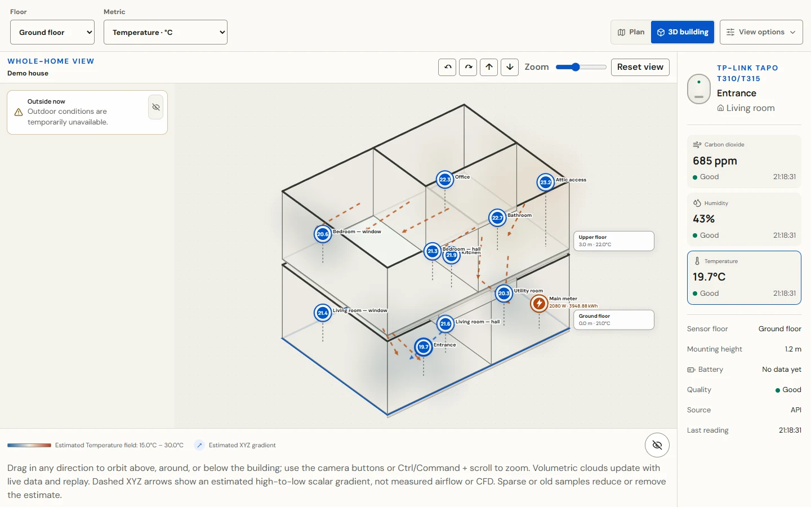
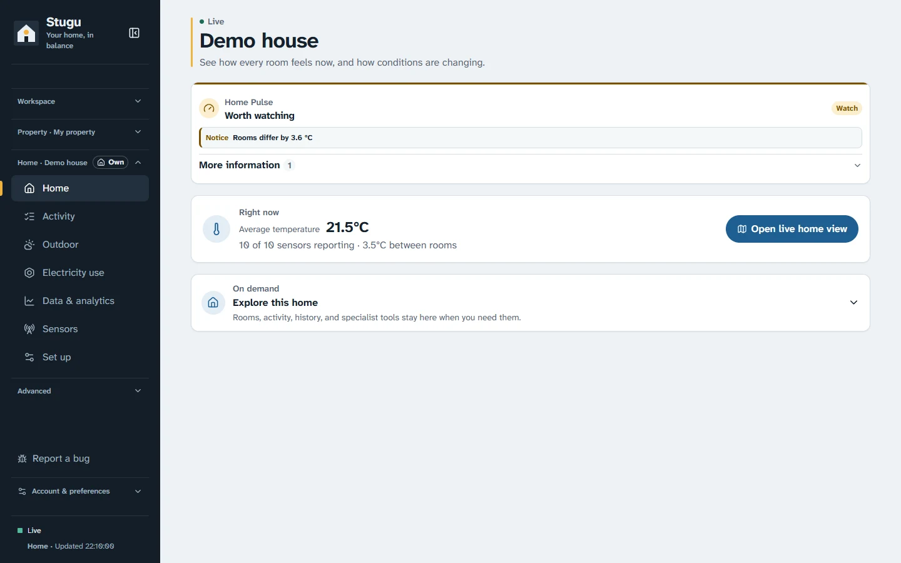
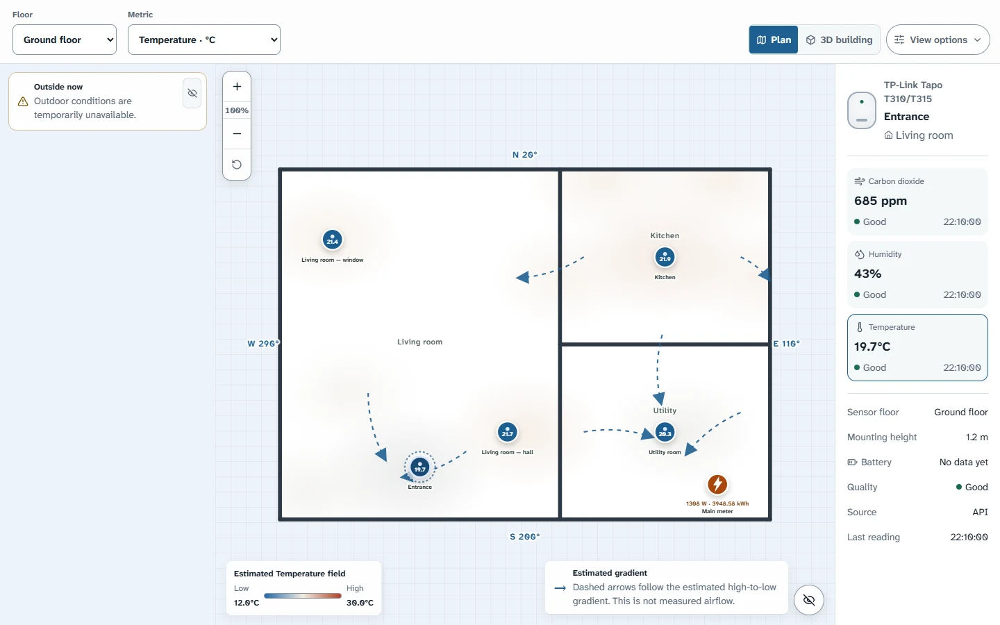
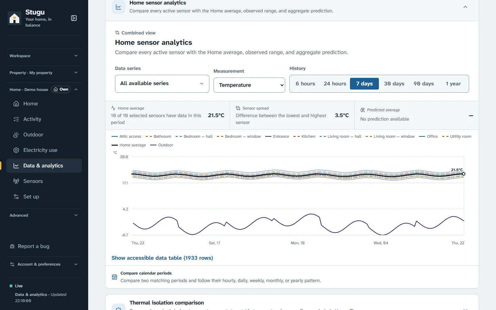
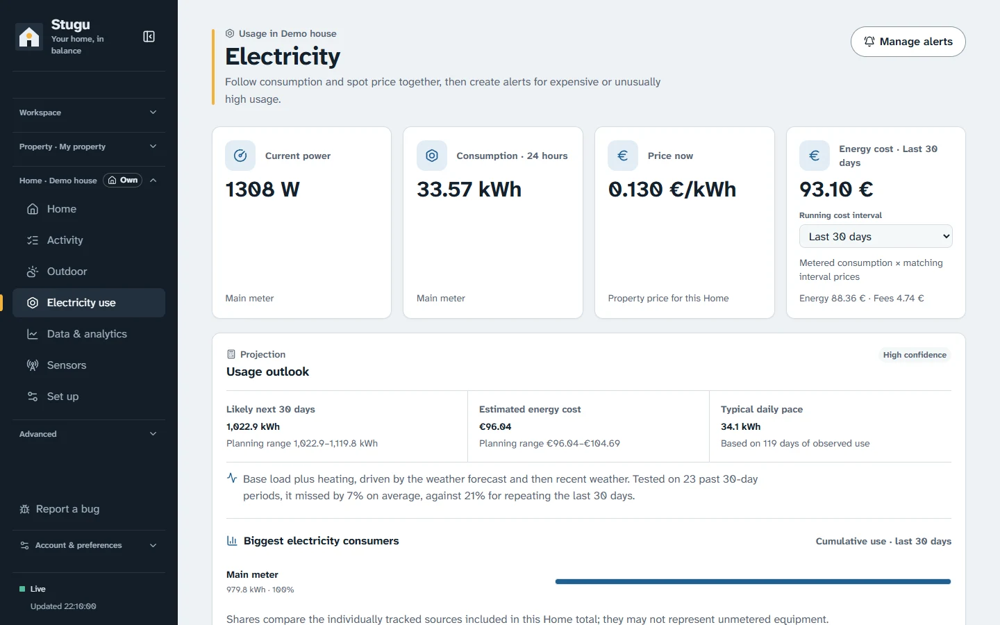
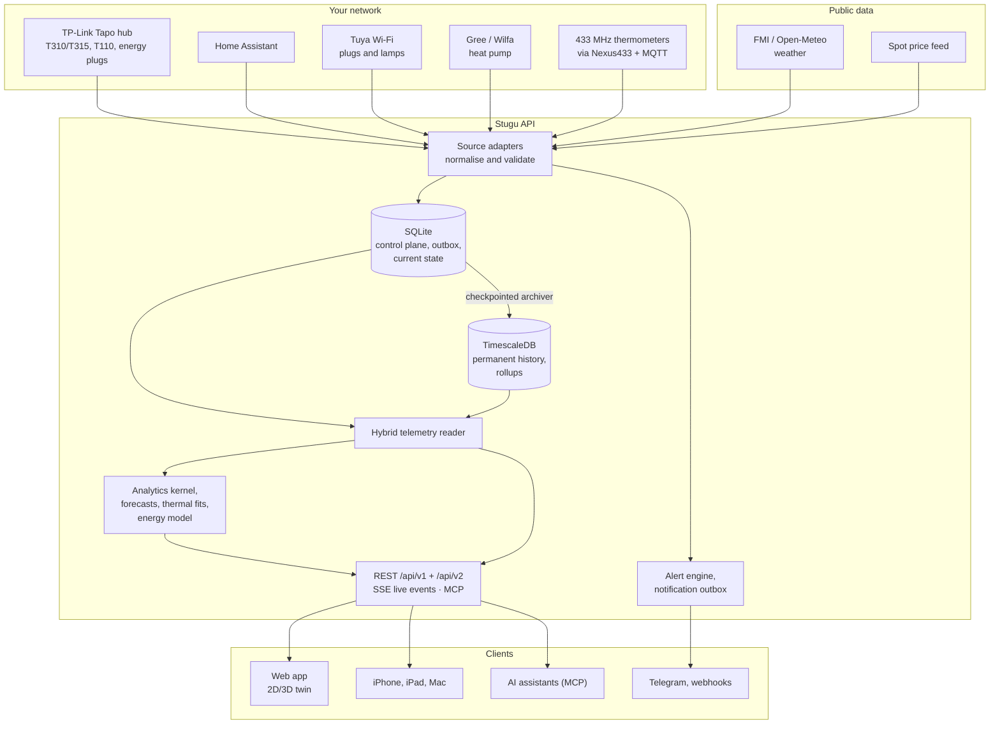
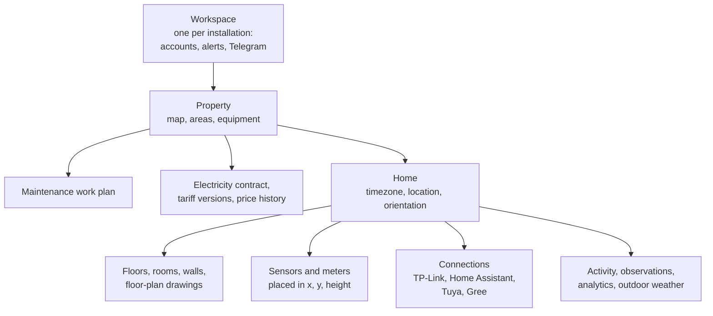
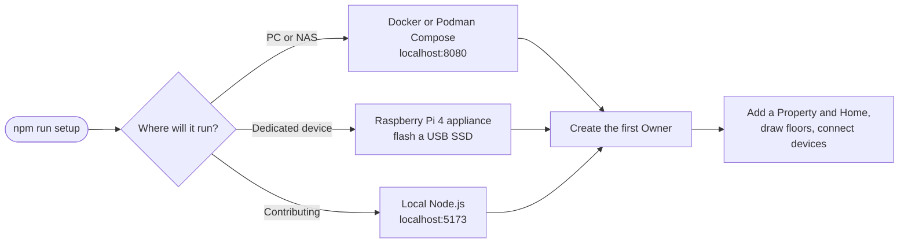

<p align="center">
  
</p>

<h1 align="center">Stugu</h1>

<p align="center">
  A local-first digital twin for the indoor climate of your home, your cottage,
  or several homes on one property.
</p>

Stugu collects temperature, humidity, CO₂, door and window, heat-pump and
electricity readings from devices on your own network. It places them on your
floor plan in 2D and 3D and turns the history into analytics you can check:
comfort, moisture, thermal behaviour, forecasts that must beat "no change",
energy cost under your real tariff, and alerts. It runs on your own hardware,
either Docker or Podman Compose on a PC or NAS or a dedicated Raspberry Pi 4
appliance. You don't need a cloud account.

<picture>
  <source media="(prefers-color-scheme: dark)" srcset="docs/images/screenshots/twin-3d-dark.webp">
  
</picture>

<sub>All screenshots show the built-in sample home with synthetic data.</sub>

## Contents

- [What Stugu does](#what-stugu-does)
- [A look around](#a-look-around)
- [How it works](#how-it-works)
- [Quick start](#quick-start)
- [Connect your devices](#connect-your-devices)
- [Remote access and sharing](#remote-access-and-sharing)
- [Backups, updates and moving to new hardware](#backups-updates-and-moving-to-new-hardware)
- [API, live events and MCP](#api-live-events-and-mcp)
- [Development](#development)
- [Documentation](#documentation)
- [Scope](#scope)

## What Stugu does

| Area | What you get |
| --- | --- |
| **See the home live** | A 2D floor plan and an orbitable 3D building with every floor, room and sensor height. Readings become soft temperature, humidity or CO₂ clouds, plus an estimated air-movement layer that is always labelled as an estimate. |
| **Know what needs attention** | Home Pulse, room comfort, a moisture and ventilation coach, and monitoring that names the stale sensor or open alert instead of showing a score. Threshold alerts go to Telegram and webhooks. |
| **Understand the history** | A data explorer from 6 hours to 1 year. Side-by-side comparisons of two days, weeks, months or years, daily notable changes with false-discovery control, thermal and moisture response fits with 90 % intervals, and CSV/Excel import and export. |
| **Forecast honestly** | Each sensor's forecast is backtested every day against "no change" and "same time yesterday". A forecast that does not beat "no change" at six hours is not shown. |
| **Follow electricity** | Spot prices, dated tariff versions, an hourly cost under the contract in force, a bill check against your invoices, a 30-day projection tested on your own history, and savings from shifting measured flexible loads. |
| **Look after the property** | Properties with several Homes, drawn outdoor areas, equipment, a maintenance work plan with completion and verification, and manual observations with revision history. |
| **Keep the data yours** | Readings and floor plans stay on your machine: a crash-safe SQLite control plane, permanent TimescaleDB history, verified backups, optional encrypted off-site copies, and live migration to new hardware. |
| **Connect what you have** | TP-Link Tapo hubs and energy plugs directly, Home Assistant, Tuya Wi-Fi devices, Gree/Wilfa heat pumps, Nexus 433 MHz thermometers, FMI and Open-Meteo weather, REST and SSE, MCP for AI assistants, and native iPhone, iPad and Mac apps. |

The interface is available in English, Finnish and Swedish, with metric or
imperial units. Owners, administrators and read-only Guests sign in to one
local workspace; Guests can be limited to selected Properties, Homes and areas.

## A look around

<table>
  <tr>
    <td width="50%">
      <picture>
        <source media="(prefers-color-scheme: dark)" srcset="docs/images/screenshots/home-dark.webp">
        
      </picture>
      <p><b>Home.</b> Home Pulse says whether anything needs attention and why, and what the rooms feel like right now.</p>
    </td>
    <td width="50%">
      <picture>
        <source media="(prefers-color-scheme: dark)" srcset="docs/images/screenshots/twin-2d-dark.webp">
        
      </picture>
      <p><b>Live plan.</b> Sensors on the floor plan with compass bearings, an estimated field and estimated gradient arrows, each labelled as an estimate.</p>
    </td>
  </tr>
  <tr>
    <td width="50%">
      <picture>
        <source media="(prefers-color-scheme: dark)" srcset="docs/images/screenshots/analytics-dark.webp">
        
      </picture>
      <p><b>Data & analytics.</b> Every sensor against the Home average and outdoors, with coverage, spread, an accessible data table and export.</p>
    </td>
    <td width="50%">
      <picture>
        <source media="(prefers-color-scheme: dark)" srcset="docs/images/screenshots/electricity-dark.webp">
        
      </picture>
      <p><b>Electricity.</b> Power, consumption, the price you pay now, cost under your tariff, and a projection that says how well it did on past months.</p>
    </td>
  </tr>
</table>

## How it works

Every reading takes the same path, whatever device it came from. Stugu commits
it to SQLite first and archives it to TimescaleDB afterwards. Live events,
charts, analytics, the MCP server and the apps all read through one hybrid
reader that merges the two stores.



- **The browser never talks to your devices.** The API owns credentials,
  polling, normalisation, alert evaluation and provider calls. Credentials you
  enter in the UI are write-only and live in a protected secrets file, not in
  the database.
- **Live means near real time.** Direct TP-Link polling defaults to every two
  seconds and door/window logs to every 500 ms. Each metric keeps its own
  timestamp, so the UI can show a stale sensor as stale.
- **Derived values are never stored as measurements.** Forecasts, interpolated
  fields, thermal simulations and estimated airflow carry their algorithm
  version and evidence, and appear only where they passed their checks.

Everything is owned by a Property or a Home, and the navigation follows that
ownership:



See [Architecture](docs/architecture.md) for the full runtime view, storage
model, analytics pipeline and module boundaries.

## Quick start

With Node.js 22.13 or newer installed, run the guided setup:

```sh
npm run setup
```

It asks which runtime to use (local Node.js, Docker, Podman, or the Raspberry
Pi appliance), whether this is a real home or a disposable demo, and which
local port to use. Containers serve the app on <http://localhost:8080>, bound
to loopback. Then open the app, create the first Owner, and follow the guided
Property-and-Home setup.

Non-interactive examples:

```sh
npm run setup -- --mode docker --real --start --no-cloudflare --yes
npm run setup -- --mode podman --real --start --no-cloudflare --yes
npm run setup -- --mode rpi --pi-action flash
```

To try Stugu without any hardware, set `MOCK_ENABLED=true` in `.env` before the
first start. The demo seeds the sample home from the screenshots: two floors,
ten sensors, and synthetic temperature, humidity and CO₂. Demo mode is
permanently switched off the first time real data arrives, and its synthetic
readings are deleted.

For development:

```sh
npm run setup -- --mode local --real --yes
npm run dev
```

The web app runs on <http://localhost:5173> and the API on
<http://localhost:8787> (`/api/v1` and `/api/v2`).



See [Install and run](docs/getting-started.md) for manual Compose setup, LAN
access, demo mode and uninstalling, and the
[Raspberry Pi appliance guide](docs/raspberry-pi-appliance.md) before writing a
disk.

## Connect your devices

Each connection belongs to one Home. Open the Home's **Set up → Connections**,
let Stugu scan the LAN, and enter credentials there.

- **TP-Link Tapo (direct):** Stugu polls H100/H200/H500 hubs and their
  T310/T315 climate sensors and T110 contact sensors on the LAN through
  `python-kasa`. Energy plugs such as the P110 provide power and energy. Home
  Assistant is not required. Missing history is recovered from the hub's
  retained buckets first. → [Direct TP-Link](docs/tp-link-direct.md)
- **Home Assistant:** keep the official TP-Link Smart Home integration and give
  Stugu the URL and a long-lived token. When both paths see the same sensor,
  Stugu keeps one sensor, uses the direct path while it is healthy and fails
  over to Home Assistant without duplicating history. →
  [Home Assistant](docs/home-assistant.md)
- **Tuya Wi-Fi devices:** supported lamps, outlets and switches are verified
  and controlled on the LAN with a write-only local key. Only devices that
  measure power count towards energy. → [Local Tuya](docs/tuya-local.md)
- **Gree/Wilfa heat pumps:** read-only monitoring, locally first or through
  EWPE Smart, shown in the 2D/3D Home. → [Gree heat pumps](docs/gree-direct.md)
- **Weather and prices:** Finnish Homes get observations, forecasts and
  official warnings from FMI; other locations use Open-Meteo. Neither needs an
  API key. Spot prices come from Pörssisähkö or a compatible feed. →
  [Weather](docs/weather.md), [Electricity prices](docs/electricity-prices.md)
- **433 MHz thermometers:** on the Raspberry Pi appliance, Nexus-protocol
  sensors arrive through an optional receiver container and a private MQTT
  broker. → [Nexus433 runtime](docs/nexus433-runtime-decision.md)
- **Older Tapo history:** an optional, disabled-by-default Android export
  workflow can recover history beyond the hub's retention. →
  [Tapo history recovery](docs/tapo-history-automation.md)

## Remote access and sharing

A Compose install binds the web port to loopback, and the Raspberry Pi
appliance listens only on the private LAN and Tailscale. Sign-in does not
encrypt traffic. To use Stugu from elsewhere, choose one of these, all optional
and run by you:

- **Tailscale** is built into the Raspberry Pi appliance.
- **Cloudflare Tunnel + Access** can be provisioned from the UI or the setup
  wizard so no host port is exposed. Stugu itself is not hosted on Cloudflare.
  → [Cloudflare Tunnel and Access](docs/cloudflare-access.md)
- **Stuguby** federates independently run Stugu installations around a shared
  property, with signed events and explicit per-Home grants. Shared Homes are
  read-only by default. → [Stuguby federation](docs/stuguby.md)

Read [Security, privacy and retention](docs/security-privacy.md) before binding
the web port to a LAN address.

## Backups, updates and moving to new hardware

```sh
docker compose --profile maintenance run --rm stugu-backup
```

A backup set holds both SQLite databases, assets, the Stuguby node identity,
the protected integration secrets and a full TimescaleDB dump. Treat it as
sensitive. The always-on scheduler keeps verified recovery sets in a managed
volume or a mounted NAS directory, and an optional profile replicates
encrypted copies to Cloudflare R2. →
[Backend storage](docs/backend-storage.md),
[R2 backups](docs/cloudflare-r2-backups.md)

**Updates** come from GitHub Releases. Under **Advanced → System**, Owners
choose manual or scheduled automatic installs and whether to include preview
releases. A separate update agent backs up, pulls digest-pinned images,
recreates the services, checks their health, and rolls back if the new version
does not come up. →
[System updates](docs/system-updates.md)

**Moving** a running Compose install to a Stugu appliance takes an optional
online seed and then a short, verified cutover with rollback:

```sh
npm run migrate -- seed --target stugu@stugu.local --identity-file "$HOME/.ssh/stuga_appliance"
npm run migrate -- cutover --target stugu@stugu.local --identity-file "$HOME/.ssh/stuga_appliance"
```

→ [Live system migration](docs/live-migration.md)

## API, live events and MCP

- `/api/v1` is the compatibility contract; `/api/v2` serves registered
  measurements, analytics queries and live measurement events (SSE). The
  OpenAPI document covers every route. →
  [API, MCP and integrations](docs/integrations.md)
- Stugu is also a read-only **MCP server**, so an AI assistant can look up
  Homes, current conditions, history, forecasts, energy, alerts and maintenance
  without copying your telemetry anywhere. Start the network server from
  **Advanced → API & MCP** and copy its endpoint and one-time token, or spawn
  the stdio server locally:

  ```json
  {
    "mcpServers": {
      "stugu": {
        "command": "node",
        "args": ["apps/api/dist/mcp-server.js"],
        "cwd": "/absolute/path/to/open-stuga"
      }
    }
  }
  ```

  To ask **Claude or ChatGPT** about your Homes, paste
  `https://<your Stugu>/api/v1/mcp` into the assistant and approve the
  connection in Stugu. → [Claude and ChatGPT](docs/assistants.md). A smaller
  tool set tuned for ChatGPT and voice answers also runs with
  `npm run mcp:chatgpt`. → [ChatGPT and voice](docs/chatgpt.md)

Both MCP servers advertise read-only tools only: they cannot create, change,
delete or control anything, and credentials cannot be set through them.

## Development

| Path | What lives there |
| --- | --- |
| `apps/api` | Express API, SQLite control plane, background services, OpenAPI document, MCP servers, Python device bridges |
| `apps/web` | React + Vite UI, locale catalogs, pages and panels |
| `apps/ios` | Native iPhone companion and the iPad/Mac client |
| `apps/tapo-export-runner` | Optional Tapo history export runner |
| `apps/bug-report-relay` | Optional Cloudflare Worker that relays bug reports into a private GitHub repository |
| `packages/contracts` | Shared types and validators used by the API, web and relay |
| `packages/analytics-kernel` | The one implementation of statistics, counter/kWh integration, time-weighted means and local-calendar helpers |
| `packages/spatial-layers` | Spatial inference engines |
| `packages/stuguby-protocol` | Stuguby peer protocol |
| `scripts/` | Setup, local CI, release publishing, update agent, live migration and their tests |
| `deploy/` | Compose extras, MQTT/Nexus433 images, Raspberry Pi image and host updater |

```sh
npm run build                       # packages, then API, then web
npm test -w @climate-twin/api
npm test -w @climate-twin/web
npm run typecheck                   # size, architecture, complexity and unused-symbol gates, then types
npm run verify:local -- --fast      # affected checks while iterating
npm run verify:local -- --full      # the authoritative gate and its receipt
```

Hosted GitHub Actions CI is paused; `npm run verify:local -- --full` is the
gate (Node.js 22.22.2+, Python 3.13 and Docker Desktop). The repository
enforces OpenAPI and locale parity, no hard-coded UI strings, file-size and
cognitive-complexity ceilings, architecture boundaries and an unused-symbol
ratchet. Every pull request bumps the version: minor for features, patch for
fixes and docs. Start with [CONTRIBUTING.md](CONTRIBUTING.md),
[local CI](docs/local-ci.md) and [versioning](docs/versioning.md).

## Documentation

The [documentation index](docs/index.md) lists every guide. Good places to
start:

- [Install and run](docs/getting-started.md)
- [Architecture](docs/architecture.md)
- [Analytics foundation](docs/analytics-foundation.md) and
  [thermal simulation](docs/thermal-simulation.md)
- [Electricity prices and contracts](docs/electricity-prices.md)
- [Properties and Guest access](docs/property-management.md)
- [Known limitations](docs/known-limitations.md)
- [Changelog](CHANGELOG.md)

## Scope

Stugu is pre-1.0 engineering software for understanding a home, not a certified
building-safety system. Spatial fields are interpolation estimates, and air
movement is a sensor-constrained sketch, not measured airflow or calibrated CFD.
Forecasts are shown only where they beat simple baselines on recent history.
Alerts and observations do not replace calibrated leak detectors, CO alarms,
inspections or professional advice. See [known limitations](docs/known-limitations.md).

## License

Stugu is open-source software under the [MIT License](LICENSE). Contributions
are welcome; read [CONTRIBUTING.md](CONTRIBUTING.md) before opening a pull
request. Report vulnerabilities privately as described in
[SECURITY.md](SECURITY.md).
