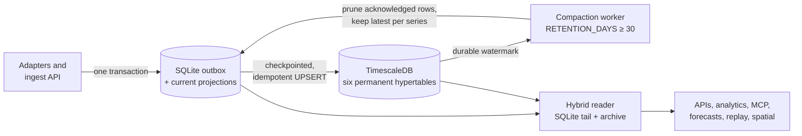

# Backend storage and operations

Stugu uses a hybrid local-first backend. Core SQLite keeps the transactional control plane, a crash-safe unacknowledged telemetry outbox, and latest-value projections. PostgreSQL with TimescaleDB is the permanent, query-optimized store for raw Home telemetry history. A separate SQLite database contains optional experimental spatial state, and a bounded process-local cache accelerates repeatable reads.

## Responsibilities

| Layer | Owns | Does not own |
| --- | --- | --- |
| Core SQLite (`DATABASE_PATH`) | Authentication and access state, canonical properties/houses/areas/floor plans and sensors, alerts and automation state, the telemetry outbox/current projections, privacy-bounded opt-in equipment-tracking evidence, and opt-in Stuguby federation state/replicas | Long-term raw climate/energy/opening telemetry history, experimental model state, Stuguby private keys, or integration secrets |
| TimescaleDB (`telemetry` schema) | Permanent raw measurement (temperature, humidity, CO2, power, energy, and custom metrics), legacy-reading, outdoor-weather, electricity-price, opening-state, and local/cloud heat-pump observation history; time bucketing; cold-chunk optimization | Identity, authorization, configuration, or secrets |
| Spatial SQLite (`SPATIAL_LAYERS_DATABASE_PATH`) | Experimental overlays/configuration, bindings, calibrations, context, jobs/checkpoints, model runs, ground truth, and derived snapshot revisions | Property/sensor masters or raw telemetry samples |
| In-process cache | Small, bounded, reconstructible response DTOs and snapshots | Writes, sessions, credentials, queues, or durable state |

This split keeps ingestion crash-safe while allowing years of telemetry to be partitioned and aggregated efficiently. During a TimeDB outage SQLite accumulates unacknowledged rows; it is not pruned until reconciliation is durable.



Compaction runs only while the archive is healthy and caught up; with
`RETENTION_DAYS=0` it never runs and SQLite keeps a complete duplicate.

Experimental equipment tracking is a separate privacy boundary rather than permanent Home telemetry. Its radio observations, gateway rollups, inferred locations, and movement events remain in SQLite under explicit per-Property retention limits; current locations are projections. Moving that sensitive location evidence into the permanent TimeDB archive would defeat those deletion guarantees.

## SQLite control plane

All authoritative non-time-series application state is durable in SQLite. The core database contains:

- local accounts, password and session hashes, workspace membership, invitations, and scoped Guest grants;
- Properties, Homes, complete floor-plan aggregates, map placement and orientation, areas, fixed assets, equipment, equipment attachments and links, notes, electricity contracts, and binary floor-plan assets;
- sensors, measurement definitions, Home Assistant entity bindings, TP-Link device bindings, alert rules, alert history, the durable alert-evaluation queue, alert evaluation state, and the notification outbox;
- observations and revision history, maintenance tasks and revision/evidence links, static parameters, weather-outage recovery state, operational latches, and selected demo state;
- non-secret integration identity, ownership, endpoint metadata, lifecycle state, and revision history.
- Stuguby rosters, invitation hashes, Home publication/grant metadata, Property
  adoptions, Home projections, authority epochs/transfers, durable Property and
  Home command queues/conflicts, outbox/inbox/cursors, per-recipient event logs,
  replay IDs, shared-Property aggregates, separately indexed remote raw
  telemetry, recovery manifests, asset authorization, deletion receipts, and
  federation audit rows.

Property creation and other multi-row aggregate changes use SQLite transactions. Foreign keys are enabled on every connection, WAL mode permits concurrent readers during writes, and the configured busy timeout handles short writer overlap without a heavyweight database service. Complete floor plans intentionally remain one JSON aggregate inside SQLite: ownership and lookup fields are relational and indexed, while one edit commits the internally consistent plan as a unit instead of exposing half-written rooms or walls.

Experimental spatial configuration, assignments, sensor-zone overlays, calibration/ground-truth data, job state, model runs, snapshots, and checkpoints use a second WAL SQLite file beside the core database. Shared connected-device and heat-pump map placement remains canonical Home layout state in core SQLite. The experimental store refers to Property, Home, floor-plan, and sensor records by ID and reads them from core SQLite; it does not duplicate those masters or raw telemetry samples. Keeping this optional/research subsystem physically separate prevents its high-churn derived state from expanding or locking the core control plane. It is still durable and included in normal backups.

Spatial rows are partitioned by the core database's persisted, non-sensitive archive-source UUID and active demo/real mode. The UUID travels with a moved or restored core database, unlike a file-path hash. An upgraded runtime transactionally re-keys an unambiguous legacy path-derived partition and refuses a collision instead of merging two histories.

Legacy Home Assistant and TP-Link mapping files are bootstrap/update inputs, not the only durable copy. Each integration manager imports a valid configured file on start even when credentials are absent or every live connection is Home-scoped. It canonicalizes known fields with locale-independent key/member ordering and atomically stores the complete non-secret JSON aggregate in core SQLite with its integration kind, verified SHA-256 content hash, monotonic revision, and creation/update timestamps. Semantic key/member reordering is a no-op. A valid file also repairs malformed, non-canonical, or hash-mismatched stored content; without a file, verification fails closed instead of trusting a damaged row. If the configured file is later absent, the compatibility bridge revalidates and uses the last SQLite revision. Home Assistant `unit`, `scale`, and `offset` options are retained; unknown fields, credentials, and the source file path are not. Duplicate Home Assistant claims for one sensor/metric are rejected. Stale sensor references are retained in the audited aggregate but filtered before active ingestion and reported as a diagnostic. This compatibility state is global only to the single legacy environment-backed connection and is never applied to Home-scoped UI connections. Historical precedence is unchanged: a Home Assistant file mapping wins for the same sensor/metric, while a TP-Link binding saved on a sensor wins over the legacy child map. An explicit empty TP-Link `devices` array clears that compatibility set without removing current sensor bindings.

Credential bytes are the deliberate exception. Home Assistant tokens, TP-Link and Telegram credentials, Tuya device IDs and local keys, complete webhook URLs/bearers/signing keys, and Apple Notes grant-token hashes remain in the owner-protected integration secrets file; putting credentials or capability-bearing URL query strings in the broad core database would weaken recovery and access boundaries. SQLite stores typed non-secret references, Home ownership, sanitized endpoints, safe display labels, provider-neutral connected-device state and placement, active/retired lifecycle state, and an append-only revision snapshot for each change. Existing version-1 secret files are reconciled on startup without rewriting live credentials. A validated file can soft-retire references that are no longer present; a missing, unreadable, or explicitly partial file never prunes last-known metadata. Records are not hard-deleted, including after a Home is removed.

Environment variables remain valid deployment overrides. An environment webhook destination set takes precedence and is mirrored atomically into the protected secrets file so a complete backup can restore it after the override is removed; SQLite receives only safe per-destination references and revisions. The legacy `primary` destination retains its `singleton` metadata reference for upgrade compatibility. If protected-file mirroring is unavailable, the environment configuration continues to operate but the backup must retain the deployment secrets separately. In-process caches, connection status, discovery results, SSE listeners, in-flight work, and replay position are reconstructible runtime state; browser storage contains presentation preferences, not authoritative Property data.

Ingestion commits to SQLite first. A reconciliation worker pages six telemetry families from that crash-safe outbox and UPSERTs them into TimescaleDB: measurements/readings, complete observed weather, electricity-price intervals with their contract-margin snapshot, door/window/vent state events, and every timestamped direct heat-pump observation. Each table has both a remote Timescale cursor and a local cursor stored inside SQLite. Reconciliation starts from the lower of the two; after a remote batch succeeds, it advances the remote cursor and only then the local cursor. A crash between those steps causes an idempotent replay rather than a gap, and a restored or rewound SQLite backup safely replays from its older local cursor even if TimescaleDB remembers a later position. A live wake-up path reduces normal archive latency, but checkpointed reconciliation remains the source of truth. SQLite history is compacted only after a stable pass and durable per-family acknowledgement.

Raw-history APIs, MCP, forecasting, energy/thermal analytics, recovery workers, daily findings, and experimental spatial inference share `HybridTelemetryReader` rather than copying historical data between subsystems. It merges the SQLite outbox/current tail with matching Timescale rows by natural key, deterministically orders and bounds results, and filters synthetic `mock`/`replay` rows in real-data mode. Exact local duplicates win; opening snapshots choose the newest state across both stores. If a requested range predates the bounded local cache and TimeDB cannot answer, the read fails closed instead of silently returning a shortened series.

The archive query starts before the synchronous SQLite read, so the two overlap. When a reconcile pass finished within the last 15 minutes, everything older than the 24-hour hot tail is known to be archived, so raw and bucketed measurement reads ask SQLite only for that tail. If the archive read then fails, SQLite is read again over the whole window before answering with `archiveState: "failed"`.

`/api/v2/analytics/query` answers are shared through an in-process cache. The key covers:

- the request without its id
- the visible sensors and each series' reporting interval
- the Home and registry revisions
- a late-history revision, which a SQLite trigger bumps whenever a measurement older than two hours is stored (imports, peer publications, delayed uploads)
- the release

A range that ended more than two hours ago is shared for up to an hour; one that reaches the open tail is shared for 30 seconds. Answers built without the merged archive are not shared, and the response's `cache.hit` and the `x-stugu-cache` header say which answers came from the cache. Energy summaries and the optimizer share one summary cache, and incomplete summaries are kept for 15 seconds rather than recomputed for every caller. Optimizer reports are dropped only when a Property, Home or sensor changes, not on live device events.

Generic measurement analytics no longer scale with the number of raw samples in
the requested range. Mergeable operations (`mean`, `sum`, `min`, `max`, and
`last`) read quality-, source-, and unit-aware continuous aggregates at 1-minute,
5-minute, 1-hour, or 1-day resolution, plus only the partial range edges from raw
data. Exact ordered operations (reset-aware counter consumption and delta,
time-weighted mean, and power/energy cost) use durable states built on demand for
the requested resolution. Those states are keyed by series, UTC day, resolution,
quality mask, source scope, and algorithm version. A single low-priority worker
materializes closed days; the current day and partial edges remain bounded raw
reads. Cost queries choose exact states adaptively: price-stable hours use hourly
states, tariff-boundary hours fall to 15-minute states, and only affected
quarters fall to minute states. Tariff allocation is a set-based hourly-slice
join, so it does not grow with the raw sample cadence. A first historical request
may return a retryable “still materializing” response instead of falling back to
a full raw scan. Later requests reuse the states, while a generation ledger makes
late-sample/import invalidation race-safe and rebuilds only affected variants.
Raw samples remain the source of truth throughout.

All Timescale cost-state requests also pass through a dedicated two-operation
store lane. This covers HTTP, MCP, optimizer, and background callers, including
the multiple internal SQL round trips needed by one exact result, while leaving
pool capacity for ingestion and reconciliation.

The raw history API is strictly bounded and uses an opaque `(observed_at,
source)` keyset cursor, so neither the database nor browser needs to materialize
an unbounded export. The browser export guard is 50,000 rows. Full-fidelity
recovery remains the verified dual-database backup path.

The time-series schema uses one-day chunks for indoor measurements/readings,
seven-day chunks for ordered states, 30-day chunks for outdoor weather, opening
events, and direct heat-pump observations, and 90-day chunks for electricity
prices. Where supported, raw chunks and ordered states enter columnstore after
seven days by default; increase the global age when late imports commonly reach
further back.
Continuous aggregates also enter columnstore on resolution-specific schedules.
These policies change representation, not retention: no raw-data retention
policy is permitted, and initialization fails if one is detected. That raw
retention check is intentionally a startup-failing safety invariant. Every
continuous-aggregate refresh policy is also mandatory: missing or failed policy
setup keeps the archive unavailable while reconciliation retries, rather than
serving a stale or raw-scanning historical result.

The base tables and query API also work on ordinary PostgreSQL. When the TimescaleDB extension is unavailable, Stugu uses ordinary aggregate views and forgoes hypertables, continuous refresh, and cold-chunk optimization; initialization reports those capabilities instead of silently claiming them.

## Stuguby storage boundary

Before adoption, structured replicas live in `stugby_remote_resources` and raw
samples in `stugby_remote_telemetry`; raw chunks are not duplicated in the
generic JSON resource table. Adoption materializes a sanitized projection in
the canonical Property/Home tables so existing UI and APIs can display it.
Ownership, authority epoch, edit policy, recovery state, pending/conflict
counts, and detached state remain explicit Stuguby metadata. Unrelated local
Properties remain separate.

Integration bindings, accounts, secrets, and automation/control capabilities
are never projected. Normal remote telemetry is not copied into the local
Timescale archive. Only an explicit permanent disconnect may promote a complete
full-recovery Home for its designated successor and import that sanitized
history as local historical data. Grant cache permissions and retention remain
enforced for non-recovery replicas. A zero-day or no-cache dataset is not
written as a durable replica.

The local Stuguby publisher does not yet stream compacted TimeDB rows into a
new historical or full-recovery grant. If the requested history is no longer
complete in SQLite's bounded cache, publication fails with
`ARCHIVED_TELEMETRY_EXPORT_UNAVAILABLE` instead of silently advertising a
shortened recovery set as complete.

The node's Ed25519 private key is stored only in `STUGBY_IDENTITY_FILE`, beside
the core database by default. It is not in SQLite, an event, an exportable
grant, or an API response. Floor-plan and recovery replicas are
content-addressed files below the configured asset directory; SQLite stores
their digest, media type, size, reference ownership, and audience/grant
authorization. Supported blobs are PNG, JPEG, WebP, glTF, and GLB. Revocation
and retention remove unreferenced replica files; pre-event uploads have a
bounded temporary staging allowance. Back up the identity, database, and assets as
one recovery unit. For the complete protocol and lifecycle, see
[Stuguby federation](stuguby.md).

## Retention and idempotency

Fresh generated configuration sets `RETENTION_DAYS=30` to keep a bounded SQLite
hot cache after durable acknowledgement. An existing installation that omits
the key retains the backwards-compatible `RETENTION_DAYS=0`, which disables
compaction and keeps a complete redundant SQLite history. The Timescale schema installs no raw-data retention policy, so
raw history remains permanent in either mode. When TimeDB is deliberately
disabled for standalone development, SQLite necessarily retains the only
history and is not compacted.

Before each compaction the worker requires a healthy, caught-up archive with all six hypertables, flushes mutable rows, proves a stable pass, and takes per-table archived watermarks. It preserves the latest local row for each sensor/metric, legacy sensor, outdoor location, opening identity, and heat-pump connection, plus current/future electricity-price intervals. Rows newer than a durable watermark are never removed. If an older query needs compacted history while TimeDB is unavailable, the API fails closed instead of silently returning an incomplete series. Operational prerequisites remain:

1. The archive backfill has completed.
2. Verification against the source snapshot succeeds.
3. Both SQLite and PostgreSQL backups have been restored in a test environment.
4. Monitoring shows sufficient archive capacity.

The shared archive-plus-current-tail reader keeps regular raw history, bucketed
thermal history, replay, MCP, forecasts, energy analysis, opening activity, and
spatial derivation on the same permanent source. Old ranges explicitly fail
when they depend on an unavailable TimeDB. Verified backups must cover both
databases: SQLite contains the control plane and unsent outbox, while Timescale
contains the permanent telemetry history.

Archive writes use natural keys and UPSERTs, so retrying a batch is safe. The keys are:

| Series | Natural key |
| --- | --- |
| Measurement | `sensor_id, metric, observed_at, source` |
| Legacy reading | `sensor_id, observed_at, source` |
| Outdoor temperature | `house_id, location_key, observed_at, source` |
| Electricity price | `property_id, starts_at, source` |
| Opening state | `observation_id, observed_at` |
| Direct heat-pump state | `connection_id, observed_at` |

Changing a source identifier changes the identity of a sample. Do not rewrite source names during import unless the duplication is deliberate.

## Historical ownership lineage

The current raw indoor schema identifies a series by sensor ID, while access control resolves that sensor through its current Home and Property. Deleting a Home therefore records a tombstone and hides the Home plus its Home-owned projections without physically deleting their rows; Property-owned maintenance, notes, and equipment remain intact. Stugu still fails closed when a Home with real telemetry is moved to another Property, when a sensor with real telemetry is moved to another Home, or when a telemetry-owning sensor or Property is hard-deleted. Archiving the samples first does not make those mutations safe because it would lose or change the ownership context needed to interpret them.

The planned lineage migration will capture immutable `property_id` and `house_id` context on indoor samples (and `property_id` on outdoor samples) at ingestion time, without changing those fields during an idempotent replay. Historical queries will then authorize against captured context rather than only the current sensor row. Existing rows can be backfilled once from their current ownership before reparenting is enabled; move/delete and Guest-scope regression tests are required before lifting the remaining fail-closed guards.

## Configuration

Local `npm run dev` remains a SQLite-only compatibility mode unless `TIMESERIES_ENABLED=true` is set. Docker Compose enables TimescaleDB and starts the API after the database container has started; it deliberately does not wait for database health. The API can therefore begin serving its control plane and buffering telemetry while the TimeDB worker retries initialization and reconciliation. PostgreSQL is exposed only to the Compose network; it is not published on a host port.

| Variable | Default | Purpose |
| --- | --- | --- |
| `TIMESERIES_ENABLED` | `false` locally; `true` in Compose | Enable archive initialization and use |
| `TIMESERIES_REQUIRED` | `false` locally and in Compose | Opt in to failing API startup when the archive cannot initialize |
| `TIMESERIES_HOST`, `TIMESERIES_PORT` | `127.0.0.1`, `5432` | PostgreSQL endpoint |
| `TIMESERIES_DATABASE`, `TIMESERIES_USER` | `stuga`, `stuga_app` | Database and least-privilege application role |
| `TIMESERIES_PASSWORD` | empty locally; generated password file in Compose | Write-only database credential |
| `TIMESERIES_POOL_MAX` | `6` | API connection-pool ceiling |
| `TIMESERIES_CONNECT_TIMEOUT_MS` | `5000` | Connection timeout |
| `TIMESERIES_STATEMENT_TIMEOUT_MS` | `15000` | Per-statement server timeout |
| `TIMESERIES_BATCH_SIZE` | `1000` | Maximum archive write batch |
| `TIMESERIES_COLUMNSTORE_AFTER_DAYS` | `7` | Override the raw/ordered cold-columnstore age; increase above the late-arrival/import window |
| `TIMESERIES_STORAGE_PATH` | unset locally; `/app/timeseries-data` in Compose | Same-filesystem path used for TimeDB capacity and growth alerts |
| `STUGA_TIMESERIES_DATA_SOURCE` | `stuga-timeseries-data` | Compose named volume or absolute local block/SSD path for PostgreSQL data |
| `STUGA_SCHEDULED_BACKUP_SOURCE` | `stuga-scheduled-backups` | Compose named volume or absolute mounted NAS path for scheduled recovery sets |
| `STUGA_STORAGE_ALLOWED_ROOTS` | dedicated platform roots | Host security policy limiting directories selectable in System settings |
| `STUGA_TIMESERIES_STORAGE_KIND` | `managed` | Host-agent metadata: `managed` or `local-path` |
| `STUGA_SCHEDULED_BACKUP_STORAGE_KIND` | `managed` | Host-agent metadata: `managed`, `local-path`, or `nas-path` |
| `STUGA_SCHEDULED_BACKUP_TARGET_ID` | empty | Internal mount-sentinel identity; do not copy it between targets |
| `BACKUP_MIN_FREE_BYTES` | `1073741824` | Free-space reserve required in addition to the logical database size before a dump starts |
| `RETENTION_DAYS` | `30` in fresh generated configuration; otherwise `0` | SQLite hot-cache days after acknowledgement; `0` keeps the complete SQLite duplicate |

Compose generates persistent random database-admin, application-database, and local-proxy secrets on first start and mounts them as files; it does not ship fixed database passwords. PostgreSQL is restricted to the internal Compose backend network, where the supplied API connection disables TLS. For a non-local or externally hosted database, provide the application credential through a protected secret file or secret manager, require TLS, restrict network ingress, and retain the dedicated least-privilege application role. Never log the resolved configuration or put a credential-bearing URL in source control.

The database administrator must create the configured telemetry schema and make the application role its owner before the API or migrator starts. The supplied Compose bootstrap does this automatically. The application role intentionally has no database-level `CREATE` grant, so normal runtime code cannot create arbitrary schemas.

PostgreSQL live data must stay on a local block filesystem, not SMB/NFS. Compose
can use an absolute local SSD path through `STUGA_TIMESERIES_DATA_SOURCE`.
Network-attached storage is supported for recovery sets through
`STUGA_SCHEDULED_BACKUP_SOURCE`; Cloudflare R2 remains an encrypted off-host
recovery tier, not a query tier.

Owners and Admins can connect the shared NAS under **Set up → Operations** or
configure both locations under **System → Storage** when the trusted host
update agent is connected. A host path must already exist below one of
`STUGA_STORAGE_ALLOWED_ROOTS`; Stugu never mounts a share or stores NAS
credentials. **Mounted NAS is never primary telemetry storage.** It holds
recovery sets and optional derived CSV exports. The agent verifies the network
filesystem and writes a unique sentinel. The scheduler and R2 replicator
require that sentinel on every scan, so a disconnected NAS fails closed instead
of filling the underlying local directory.

Each Home defines scheduled sensor exports under **Data & analytics**. The API
renders a bounded CSV in canonical units into the private operations directory
and publishes a checksummed request only after the file is durable. The
isolated backup scheduler validates the NAS sentinel, request schema, filename,
byte count, and SHA-256 digest before copying to
`data-exports/<schedule-id>/`; it then prunes only that schedule's older files
and returns a receipt to the API. The API container never receives writable
access to the NAS mount.

A primary telemetry move is journaled host maintenance, not a direct remount.
Before changing Compose state, the agent creates and verifies a complete backup,
runs an isolated restore drill, cleanly stops TimescaleDB, checks PostgreSQL's
shut-down control state, and copies with ownership, ACLs, extended attributes,
durable flushes, and a completion marker. It then inspects the daemon's actual
mount and verifies the PostgreSQL system/catalog identity. The API remains in
degraded ingest mode for most of the copy, so its durable SQLite outbox buffers
new samples and hot retention remains paused. An interruption resumes from the
durable journal; failed verification restores the old settings and services.
The old source is never deleted or reclaimed automatically.

The PostgreSQL data and both database-credential volumes form one recovery unit. Back them up and restore them together. If either credential volume is accidentally lost while the PostgreSQL data volume survives, stop the API, let `runtime-secrets` create replacement secrets, and run `docker compose --profile maintenance run --rm timeseries-credential-reconcile`. This maintenance job has no network interface; it reaches PostgreSQL only through the private Unix-socket volume and reconciles the administrator and least-privilege application roles with the generated files. Start the API only after the job succeeds.

The Compose image is pinned through `TIMESCALE_IMAGE`. Do not change PostgreSQL major versions against an existing data directory. Back up, create a fresh volume on the new major version, then migrate with `pg_dump`/`pg_restore` or the vendor-supported upgrade procedure.

## Cache boundaries

The cache is a dependency-free, bounded LRU with TTL, optional stale-while-revalidate, request coalescing, explicit invalidation, and no background timers. Cache only data that can be reconstructed from SQLite or TimescaleDB. The API uses a small two-second cache for raw latest measurement/legacy-reading snapshot assembly and invalidates it after relevant telemetry mutations.

Cache keys must include every representation boundary: house or property ID where the cached value is scoped, query range, resolution, units, and schema/API version. Authorization-scoped representations must also include their tenant/user visibility scope. A scope-neutral raw snapshot may be shared only when authorization filtering is applied after the cache read and before any response; that is the pattern used for latest snapshots. Invalidate affected namespaces after mutations.

Good candidates are short-lived assembled latest-state snapshots and expensive historical aggregates. Do not cache authentication or bootstrap responses, integration credentials, mutations, ingestion acknowledgements, action/notification state, SSE streams, or unbounded raw history. A cache outage or process restart must not affect correctness.

## Failure and degraded operation

`TIMESERIES_REQUIRED=false` is the local and Compose default. The API remains available on its SQLite control plane and durable local buffer while the archive starts or recovers, and the worker retries initialization and checkpointed reconciliation. Set `TIMESERIES_REQUIRED=true` only when strict fail-closed startup is operationally preferable; in that mode the API fails startup if the archive cannot initialize.

During a TimeDB interruption, do not manually purge, replace, or discard SQLite. The API continues committing locally when degraded operation is allowed; after PostgreSQL recovers, reconciliation resumes from the minimum of the local and remote cursor for each table. Compaction pauses until the archive is healthy, caught up, freshly reconciled, and free of mutable dirty rows. Long-range queries may be unavailable while degraded, but the control plane and current local operations remain available.

Use short connection and statement timeouts so an archive fault does not exhaust API workers. Keep the pool small relative to PostgreSQL `max_connections`; the supplied Compose defaults use a pool of 6 and a server ceiling of 30. Investigate repeated pool errors, growing PostgreSQL waiters, migration checkpoints that stop advancing, or divergence between source and destination counts.

## Migration

The migration tool reads SQLite in read-only mode, checks its integrity and schema, creates a committed-WAL-aware snapshot for a real run, and migrates in transactional batches. Before the first batch it requires/enables TimescaleDB, converts all six destination tables to validated hypertables with the canonical time columns and chunk intervals, and uses a dedicated maintenance timeout rather than the API's 15-second statement timeout. Optional outdoor `conditions_json` and typed heat-pump state JSON are syntax-validated and preserved; older SQLite schemas without conditions, price margins, opening observations, or heat-pump observations remain supported. It writes a checkpoint after each committed batch. Inserts use natural keys with `ON CONFLICT DO NOTHING`: an older snapshot can never overwrite an existing destination row, and exact post-import verification includes the resulting metadata and fails if a colliding destination payload differs. It never deletes source or destination rows.

Run migration as single-writer maintenance: stop the API, archive worker, and every other process that can write the target schema for the full import and verification window. The tool acquires the destination/schema PostgreSQL advisory lock before its checkpoint-file lock, for both migration and verify-only runs. A lock records a random owner token and the durable database fingerprint. If a one-off container is killed, a replacement may remove its foreign-host lock only after acquiring the same database advisory lock and matching that fingerprint; delayed cleanup from the old owner cannot remove the replacement lock. This prevents concurrent CLI writers while allowing automatic recovery across changing container hostnames. The advisory lock cannot prevent ordinary application writes. After raw-table verification succeeds, the tool creates or validates the fixed measurement continuous aggregates and refreshes the imported historical range at 5-minute, 1-hour, and 1-day resolutions under the same maintenance timeout.

First inspect the source without creating files or connecting to PostgreSQL:

```powershell
node scripts/migrate-telemetry-to-timescale.mjs --source ./data/climate-twin.sqlite --dry-run
```

For the standard Compose deployment, use the dedicated maintenance service. It reads the existing SQLite volume and the application-role password file on the private backend network, so PostgreSQL does not need a host port and the password is not placed in shell history. Stop both serving containers before taking the snapshot, keep them stopped through the independent verification pass, and restart them only after both commands succeed:

```powershell
docker compose stop web api
docker compose up -d runtime-secrets timescaledb
docker compose --profile maintenance run --rm telemetry-migrate
docker compose --profile maintenance run --rm telemetry-migrate `
  node /app/scripts/migrate-telemetry-to-timescale.mjs `
  --source /app/data/climate-twin.sqlite --verify-only
docker compose up -d api web
```

If either migration command fails, leave the API stopped, preserve the generated snapshot and checkpoint, inspect `docker compose logs timescaledb`, and rerun the same command after correcting the cause. The migration is resumable and idempotent. Do not start the API merely to test a partial import, and do not delete or replace SQLite. A non-Compose migration can instead use `TIMESCALE_DATABASE_URL`, but any temporary PostgreSQL publication must be loopback-only and removed immediately afterward; never publish PostgreSQL to a LAN for an import.

By default the tool places a consistent `*.timescale-migration.snapshot.sqlite` and resumable `*.timescale-migration.json` checkpoint beside the source. Both contain sensitive household or database metadata. The tool requests owner-only file permissions and a private Windows ACL, but they must still live on a protected, preferably encrypted destination. Keep both until verification and a restore drill succeed. Re-run the same command with the same source, snapshot, checkpoint, destination, and schema to resume. The destination fingerprint uses the durable PostgreSQL database OID, database/user names, and schema, not a container IP or port, so recreating a container around the same database volume does not invalidate recovery. Legacy checkpoints whose transport-based fingerprint no longer matches may be rebound only by a successful `--verify-only` pass over an already complete import; an incomplete legacy checkpoint fails closed. Use `--snapshot` and `--checkpoint` to place these files in a protected backup directory, `--batch-size` to tune batches, and `--schema` only when intentionally isolating an import.

`--verify-only` compares the existing destination with the consistent snapshot; it does not update PostgreSQL. If the live SQLite database has changed since migration, verify against the migration snapshot rather than assuming live row counts must be identical. Preflight normalizes timestamp keys to PostgreSQL `timestamptz` semantics, so two textual offsets that identify the same instant are rejected as a collision before import.

Treat one target schema as one logical deployment. Import multiple historical SQLite databases into the same schema only after confirming that their natural keys and identities belong together: a collision retains the existing destination row, and verification rejects the import if the payloads differ. Preserve unrelated development databases as verified backups or migrate them to deliberately separate schemas.

## Backup and restore

Back up both authoritative stores. A PostgreSQL dump alone omits control-plane data and integration configuration; a SQLite snapshot alone omits the durable archive. Every backup is sensitive: core SQLite contains authentication/session hashes and household state, assets may reveal the home, and Timescale contains occupancy-adjacent telemetry. Keep sets outside Docker volumes on a protected, encrypted destination and encrypt every off-host copy, whether or not integration secrets are included.

The repository backup CLI produces a transparent directory with consistent SQLite snapshots, copied assets, the Stuguby node identity when present, an optional full-database custom-format PostgreSQL dump, and a checksummed manifest. It creates the root as `0700` and files as `0600` where POSIX permissions apply; on Windows it removes inherited access and grants the current account a private ACL, failing closed if that cannot be done. These controls do not replace disk encryption. The full database is required to preserve TimescaleDB hypertable chunks and catalog relationships; a schema-filtered dump is not a safe substitute. By default the CLI backs up the core database, the spatial database when present, the Stuguby identity, and the assets directory. Integration secrets and TimescaleDB are explicit opt-ins. It never overwrites an existing output directory; an interrupted or failed run remains marked `INCOMPLETE`.

For Compose, the preferred complete backup path is the maintenance-only image. It contains matching PostgreSQL 17 client tools without adding them to the production API image, reads the databases through private volumes/networking, and writes to `./backups` (or `STUGA_BACKUP_DIRECTORY`):

```powershell
docker compose --profile maintenance run --rm stugu-backup
docker compose --profile maintenance run --rm --no-deps stugu-backup `
  --verify /app/backups/<backup-directory>
```

This command deliberately includes both SQLite databases, assets, integration secrets, and a full TimescaleDB dump. Its output therefore contains the complete sensitive household recovery set; move the verified directory to encrypted off-host storage. The service does not publish PostgreSQL or require `pg_dump` on the host.

The always-on scheduler writes verified sets and performs restore drills from
the private `stuga-scheduled-backups` named volume by default. Set
`STUGA_SCHEDULED_BACKUP_SOURCE` to an absolute mounted NAS directory to place
those sets there directly; verify its permissions and durability first. The
same choice is available under **System → Storage** and additionally installs
the fail-closed mount sentinel. The
named-volume default avoids host UID/GID and ACL differences across rootful
Docker, rootless Docker/Podman, Docker Desktop, and Podman machine. Before
`pg_dump`, the backup process verifies that the destination has at least the
logical database size plus `BACKUP_MIN_FREE_BYTES`; it fails closed before a
large dump can consume the database host's final reserve. Export named-volume
sets to the protected host backup directory with:

```powershell
docker compose --profile maintenance run --rm stugu-backup-export
```

The exporter copies only completed sets with a manifest and preserves any
same-named host export. Use `podman compose` for Podman. A fresh installation
with no integration-secrets file can still produce a scheduled recovery set;
the manifest records the protected source as excluded until credentials exist.
The explicit `stugu-backup` command continues to require the secrets file
because it promises a complete operator-requested recovery set.

Each automated drill re-verifies the manifest, stages the canonical SQLite,
asset, identity, and secret paths in an isolated directory, restores the full
Timescale database, reruns the recorded ownership validator, and reads every
relation plus all six telemetry families as the least-privilege application
role. It removes both candidate database and staging directory afterward and
never writes over the live stores.

For an automated off-host copy, enable the isolated `r2-backup` profile. It
streams the newest verified set through zstd and age into a private Cloudflare
R2 Standard bucket without installing the decryption identity on the node.
Follow [Encrypted Cloudflare R2 backups](cloudflare-r2-backups.md) to create the
bucket-scoped token, offline recovery identity, bucket lock, lifecycle rules,
and restore test. R2 replication does not replace the local restore drill.

Create and verify a complete recovery set before a risky migration or upgrade:

```powershell
$env:TIMESCALE_DATABASE_URL = "postgresql://<database-user>:<password>@127.0.0.1:5432/stugu"
node scripts/stugu-backup.mjs --database ./data/climate-twin.sqlite `
  --output ./backups/pre-upgrade `
  --include-timescale `
  --include-secrets --secrets-file ./data/integration-secrets.json
Remove-Item Env:TIMESCALE_DATABASE_URL
node scripts/stugu-backup.mjs --verify ./backups/pre-upgrade
```

This example again assumes a loopback-reachable database. `--include-timescale` accepts connection details through `TIMESCALE_DATABASE_URL`, `DATABASE_URL`, standard libpq `PG*` variables, or the corresponding Stugu `TIMESERIES_*` variables. It requires `pg_dump` plus `pg_restore` on `PATH` unless their paths are supplied explicitly. The verify command checks every manifest size and SHA-256, runs SQLite integrity checks, and inspects the PostgreSQL dump catalog. It does not perform a restore.

Before treating the set as recoverable:

1. Confirm `node scripts/stugu-backup.mjs --verify <backup-directory>` passes.
2. Encrypt the complete set and copy it to a protected off-host location.
3. Restore the SQLite snapshots as new files and the custom-format dump into a fresh PostgreSQL/TimescaleDB database.
4. Start an isolated API against the restored stores and check representative recent and historical queries.
5. Run migration `--verify-only` against the restored archive and its matching SQLite snapshot.

The SQLite snapshot includes its local archive cursors and stable archive source identity. It can therefore be paired with a later copy of the same Timescale archive: the worker starts from the lower local/remote cursor and safely replays rows through natural-key UPSERTs. This protects against checkpoint gaps; it cannot recreate telemetry absent from both restored stores, so backup frequency still defines the recovery point.

The manifest includes the restore sequence, but restoration is intentionally not automatic. Dumps preserve owner metadata: first bootstrap a separate empty target with matching PostgreSQL/TimescaleDB versions and the same recorded `stuga_admin`/`stuga_app` roles. Run the manifest's guarded `preRestoreSql`; it refuses a non-empty telemetry schema, removes only the empty bootstrap schema, and then calls `timescaledb_pre_restore()`. Restore serially with the recorded command. Do not add `--no-owner` and do not use parallel `-j` jobs. After `timescaledb_post_restore()` and `ANALYZE`, run the included fail-closed ownership validator; it checks the telemetry schema and relations, raw chunks, continuous-aggregate views, materialization hypertables, and their chunks are still owned by the least-privilege application role. Only then perform API/history checks and allow reconciliation. The backup CLI itself performs catalog inspection, not a live restore. The initial 2026-07-18 local cutover dump was additionally restored into a fresh network-isolated TimescaleDB 2.28.3/PostgreSQL 17 volume; row counts/ranges, rollups, ownership, and application-role reads passed before the temporary target was removed. Every later recovery point still needs its own scheduled restore drill. Never test by overwriting the only live volume, and never use `docker compose down -v` when the volumes contain the only copy of data.

## Capacity and routine operations

Estimate ingestion before choosing disk capacity:

```text
rows/day = sensors × metrics per sensor × (86,400 / sampling interval in seconds)
```

For example, 20 sensors reporting 3 metrics every 5 minutes produce 17,280 measurement rows/day, or about 6.3 million/year, before legacy readings, weather, prices, metadata, indexes, and WAL. Measure actual bytes per day after a representative month; row width and index overhead vary too much for a reliable universal byte estimate. Provision headroom for indexes, active chunks, WAL, maintenance, upgrades, and at least one local restore—not just raw values.

Useful checks include:

```powershell
docker compose ps
docker compose logs --tail 100 timescaledb api
docker compose exec timescaledb pg_isready -U stuga_admin -d stugu
docker compose exec timescaledb psql -U stuga_admin -d stugu -c "SELECT pg_size_pretty(pg_database_size(current_database()));"
```

The authenticated System page and health endpoint report SQLite and TimeDB
size, TimeDB latency/pool/query activity, free bytes on the configured TimeDB
filesystem, and a persisted 30-day growth forecast. Storage warnings trigger at
85% used or 5 GiB available; critical alerts trigger at 95% used or 1 GiB.
Medium/high-confidence forecasts warn within 30 days and become critical within
7 days. Alert transitions use the normal durable notification path, including
Telegram when configured.

Also track ingest lag, oldest/newest timestamp per series, failed archive
batches, backup age, and restore-test age. Run `ANALYZE` normally through
PostgreSQL autovacuum, refresh historical rollups after large imports, and
investigate query plans before adding indexes; every extra index increases
ingest cost. High-rate telemetry and operational queues/logs are bounded or
rolled up; authoritative low-frequency audit/revision records remain retained.

Backups are complete only after a successful restore. Keep at least one recent off-host copy and one older recovery point, and test the documented restore process on a schedule appropriate to the importance of the data.
