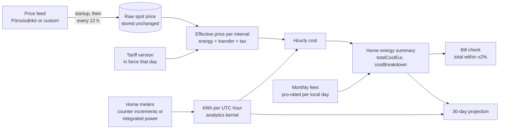

# Electricity prices and contracts

Electricity prices belong to a Property, while consumption meters belong to a
Home. This lets one Stugu installation model Properties with different
retailers, margins, or price feeds and Homes with one or several Tapo meter
devices.

## Default source

Every property receives an enabled `porssisahko` configuration automatically:

```text
https://api.porssisahko.net/v2/latest-prices.json
```

The service fetches this feed at startup and every 12 hours. A manual refresh is
available from **Property → Electricity** at
`/properties/{propertyId}/electricity` and from the REST API. Pörssisähkö v2 publishes up to
192 quarter-hour intervals. Its `price` value is cents/kWh including the VAT that
applied on that date; `startDate` and `endDate` are UTC timestamps.

Stugu stores the returned value unchanged as `rawPriceCentsPerKwh`. Every
effective price and every cost is derived from it when reading, under the
Property's tariff.

Every successful fetch first commits all source intervals to the crash-safe
SQLite outbox and immediately wakes TimeDB reconciliation. The permanent store
keeps the interval boundaries, raw price, a margin snapshot, and fetch time in
the TimescaleDB `electricity_price_samples` hypertable. Repeated fetches are
idempotent, and raw archive rows have no expiry policy. Historical API reads
merge the SQLite current/unacknowledged tail with TimescaleDB, so daily,
weekly, monthly, yearly, and later calendar-period analytics use durable price
history rather than only the latest provider response. The margin snapshot is
kept for audit only; prices and costs never use it.

## Tariff

A Property's contract is a list of dated **tariff versions**. Each version
applies from its `validFrom` local date until the next version; the earliest
version also covers every earlier date. Dates and schedules use the time zone of
the Home being costed (for Property-wide prices, its default Home's). All rates
include VAT, as on a consumer invoice.

| Part | Options |
| --- | --- |
| Energy | Spot (raw feed + margin, c/kWh), fixed price with a flat, day/night or seasonal schedule, or not entered yet |
| Transfer | None, or a flat, day/night or seasonal charge (c/kWh) |
| Electricity tax | Optional c/kWh |
| Monthly fees | Optional retailer and network fees (€/month) |

Day/night schedules treat 07:00–22:00 local time as daytime. Seasonal schedules
charge the winter rate on November–March, Monday–Saturday, 07:00–22:00 local
time, and the other rate at all other times.

```text
effectivePriceCentsPerKwh = energy + transfer + tax   (for the interval's version)
energy (spot)             = rawPriceCentsPerKwh + marginCentsPerKwh
```

While a fixed contract's energy price is not entered, effective prices fall back
to the raw spot price and costs report the energy price as missing instead of
pricing the contract at spot.

Costs are calculated per UTC hour from metered usage: spot energy uses the raw
price of the intervals the usage falls in; fixed energy, transfer and tax use the
rate in force for that local hour. Transfer and tax are charged on the same kWh
as energy, so a partly priced period stays a consistent "priced so far" figure.
Monthly fees are pro-rated by local calendar day (fee ÷ days in that month, a
25-hour or 23-hour day counting as one day) and are added once per Home
summary, as `totalCostEur`. Summaries return the split as `costBreakdown`, with
the components they include.



Properties upgraded from before 0.43 start with one open-ended version built
from the earlier contract fields: spot and "other" contracts keep their margin,
and a fixed contract has no energy price until one is entered. Until dated
versions are saved, a margin change applies to the whole history. The older
`marginCentsPerKwh`, `contractType` and `monthlyFeeEur` configuration fields
still work: they show, and update, the version in force today.

## Bill check

Invoices are entered by hand (billing dates, total, and optionally kWh and the
energy, transfer, tax and fee lines). A reconciliation calculates the Home
summary for the invoice's local billing dates and reports the error of the total
and of each entered line. The status uses the total: within ±2% counts as
reconciled.

Custom HTTPS sources are supported when they return the same JSON shape as the
Pörssisähkö `prices` response.

## Thirty-day projection

`GET /api/v1/houses/{houseId}/energy-projection` projects a Home's next thirty
days of consumption and cost. It needs a whole-Home meter or independent meters;
submeters alone return `projection: null`.

- **History:** up to 120 complete days. Each day is the meters' counter
  increments, or their integrated power, with at least 80% coverage.
- **Weather model:** a regression of daily energy on heating degree-hours below
  the Home's heating base (`heating-base-temperature`, 17 °C by default). It
  gives a base load plus a heating slope. The horizon's degree-hours come from
  the stored weather forecast as far as it reaches. After that, the forecast's
  mean is held, or the last two weeks' mean when there is no forecast.
- **Backtest:** origins every three days project thirty days from the sixty
  before them, with observed weather standing in for the forecast. They are
  scored against "repeat the last 30 days".
- **Choosing the method:** the weather model is used only when its error was
  lower than the repeat's. Otherwise the repeat is the projection, and the
  response says so.
- **Interval and confidence:** the interval comes from the chosen method's
  backtest errors (5th to 95th percentile, given at least five origins). The
  confidence comes from its mean absolute percentage error.
- **Cost:** consumption is priced at the last thirty days' cost per priced kWh,
  with that period's monthly fees added once.
- **Caching:** results are cached for up to an hour, and refreshed sooner when
  the tariff, the forecast or imported history changes.

The release gate (`apps/api/tests/energy-projection.test.ts`) requires the
weather model to beat the repeat by at least 25% lower error through a cooling
autumn.

## Optimizer savings

`GET /api/v1/properties/{propertyId}/energy-optimization` lists
`flexibleLoads`. These are device meters (not whole-Home meters or heat pumps)
whose last week of five-minute power shows at least three runs. A run lasts
10 minutes to 6 hours, clearly above the device's idle draw, and the device
must be idle more than half the time.

Each entry reports:

- the energy-weighted price the runs actually paid
- the cheapest window of the device's typical run length in the next 24 hours
- the daily saving from moving its measured daily energy into that window

These savings appear as `flexible-load:{sensorId}` insights. The baseload
insight no longer carries a savings figure, because nothing measured says how
much of a continuous load could go.

## REST API

```text
GET    /api/v1/properties/{propertyId}/electricity
PUT    /api/v1/properties/{propertyId}/electricity/config
POST   /api/v1/properties/{propertyId}/electricity/refresh
GET    /api/v1/properties/{propertyId}/electricity/tariff
PUT    /api/v1/properties/{propertyId}/electricity/tariff
GET    /api/v1/properties/{propertyId}/electricity/invoices
POST   /api/v1/properties/{propertyId}/electricity/invoices
DELETE /api/v1/properties/{propertyId}/electricity/invoices/{invoiceId}
GET    /api/v1/properties/{propertyId}/electricity/invoices/{invoiceId}/reconciliation
```

`PUT …/tariff` replaces every version and accepts the loaded `revision` to
reject a concurrent edit with 409. Invoices and reconciliations are not shown to
Guests.

The GET response contains `config`, `current`, and `prices`. Each price point
contains both raw and effective values so consumers never have to guess which
one they received.

These endpoints expose a Property aggregate. A Guest needs a direct grant for
that Property; a child Home or Area grant reveals only the minimal parent shell
and does not reveal contract metadata or the Property price history.

## Tapo meters

Direct TP-Link connections are Home-scoped. Saving a connection requires the
owning `houseId`; the server can run several local helpers at once and one helper
may expose several energy endpoints. Discovered devices include `houseId` and
`connectionId`. Persist both `tpLinkDeviceId` and `tpLinkConnectionId` on the
Stugu sensor so identical device IDs on different local hosts remain distinct.

```text
GET /api/v1/integrations/tp-link/devices?houseId={houseId}
```

TP-Link contributes `power` and, when the device exposes a cumulative total,
`energy`. It never supplies the electricity price; the property price service is
the authoritative source used for cost estimates.

Home meter and consumption detail remains available from the selected Home.
The permanent navigation item **Electricity** is Property-scoped so a Property
without any Home can still manage its contract and price source.
