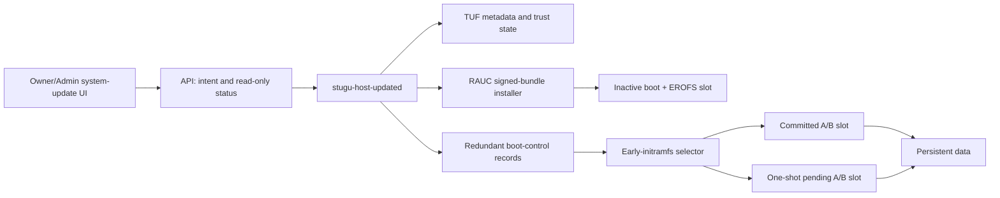

# Signed Raspberry Pi host updater

Status: exact-device preview implementation. The compiled early-initramfs boot
selector and runtime Pi/EEPROM/USB/storage fingerprint matcher are implemented.
Activation remains disabled unless a signed receipt matches that exact device.
Deployed updater-contract-3/layout-v1 appliances still require a factory
transition. Last updated: 2026-08-03.

Implemented in this repository: strict release/daemon contracts, a native
root-owned updater and CLI, TUF root-chain validation and monotonic trust state,
RAUC verity-bundle verification/install plumbing, exact-device and p6 guards,
durable activation/reconciliation state, redundant raw boot records for new
factory images, health probes, metrics, image validation, isolated RAUC signing
inputs, TUF publication verification, and a compiled selector that durably
consumes pending/probation tries before mapping the selected immutable root.
The default qualification receipt is intentionally false, so `activate` fails
closed until an exact-device receipt is embedded.

The U-Boot, 1,000-cycle, and 72-hour ring material retained later in this
document records an earlier fleet-hardening design. Those figures were internal
proposals, not requirements imposed by Raspberry Pi, RAUC, TUF, GitHub, a
regulator, or a customer. They are not gates for the bounded single-device
preview. Fleet support still requires evidence proportionate to its declared
hardware matrix.

## Decision summary

Build a native, root-owned `stugu-host-updated` service around two established
formats:

- TUF 1.0 metadata for repository trust, expiry, delegation, key rotation, and
  replay/freeze protection.
- Pinned Debian Trixie RAUC bundles for mandatory X.509 bundle signatures,
  inactive-slot writes, read-back verification, and slot status.

Keep the six-partition GPT order, offsets, and sizes exactly as they are. Never
rewrite or renumber the persistent partition. New factory layout
`stugu-gpt-ab-v2` keeps p1 at 96 MiB but formats only its first 95 MiB as FAT,
leaving a fixed raw-record tail. Deployed layout v1 formats all 96 MiB as FAT
and is not silently treated as v2.

The implemented selector is a small static C program copied into the early
initramfs. The existing firmware-topology resolver supplies the exact
firmware-selected boot partition; the selector reads the two raw-tail records,
durably consumes a pending/probation try, and maps `system_a` or `system_b`.
It never assumes `/dev/sda` or the first USB disk. The canonical p1 boot payload
is shared, so preview host bundles must carry a byte-identical boot artifact.
Kernel, firmware, EEPROM, and canonical p1 changes remain recovery-class.

Host updates and container updates remain separate transactions. The API may
request and report a host update, but only the native service may verify trust,
open block devices, write slots, or alter boot control. Before general release,
move the current container update agent's privileged Docker operations behind
the same narrow native interface and remove its Docker socket; otherwise a
compromised update-agent container remains equivalent to host root.

The result safely updates the OS, kernel, Linux firmware, boot-slot contents,
and updater contract. Pi 4 boot EEPROM and the canonical first-stage Pi boot
firmware remain recovery-class single points: they may be updated without
reflashing the SSD, but not with the same unattended power-loss guarantee.
Those operations require explicit local confirmation, verified power, and
prepared recovery media.

## Why the current OTA artifact is not sufficient

The current host image has good foundations: immutable EROFS A/B roots, an
exact USB boot-device resolver, a complete direct-boot rescue partition,
per-slot `/var`, a persistent partition, digest-pinned containers, and a
durable container-updater journal. Its `update.tar.zst`, however, is only an
unsigned pair of upstream `boot.sparse` and `system.sparse` images. There is no
production installer, signature policy, monotonic release generation,
activation transaction, data-compatibility declaration, or recovery contract.
The current release manifest is also unsigned and contract 3 intentionally
limits updates to seven containers.

The target USB incident establishes two non-negotiable facts:

1. The first FAT partition must remain independently bootable.
2. Pi-firmware redirection to later GPT FAT partitions is not a supported
   activation mechanism on this appliance.

The upstream OTA tar may remain an intermediate build input, but it must not be
published or installed as a host release.

## Target partition and component model

| Partition | Production role | Update rule |
| --- | --- | --- |
| `bootconfig` (p1, 96 MiB partition; 95 MiB FAT plus 1 MiB raw tail in layout v2) | Pi 4 firmware, stable boot shim, compact rescue, two checksummed boot-control records | Ordinary releases do not rewrite p1. Canonical Pi firmware/shim replacement is recovery-class only. |
| `boot_a` (p2, 256 MiB FAT) | Slot A kernel, initramfs, DTBs, slot manifest | Written only when A is inactive. |
| `boot_b` (p3, 256 MiB FAT) | Slot B kernel, initramfs, DTBs, slot manifest | Written only when B is inactive. |
| `system_a` (p4, 3 GiB EROFS) | Slot A immutable root | RAUC raw-image write only when inactive. |
| `system_b` (p5, 3 GiB EROFS) | Slot B immutable root | RAUC raw-image write only when inactive. |
| `persistent` (p6, ext4, grown) | App data, identity, updater state/trust cache, logs, backups, per-slot runtime state | Never included in a bundle, reformatted, moved, shrunk, or overwritten by an image update. |

The layout-v2 boot shim reads two alternating fixed-size records at fixed,
sector-aligned offsets in p1's final MiB, outside the FAT geometry. The image
validator proves that the FAT ends before the tail and that the factory tail is
zero-filled. Factory bootstrap verifies the firmware-selected disk, p1
PARTUUID, FAT bounds, record offsets, and selector hash before seeding both
checksummed copies. Thereafter Linux and the initramfs selector update only the
older record.
Each record contains a format version, sequence, appliance disk/partition
GUIDs, committed, pending, and fallback slots, host generations and bundle
hashes, per-slot `successful` and `triesRemaining` values, state, and CRC.
Writers flush, read back, and validate the new copy while the last valid record
remains intact. Any bounds, identity, receipt, or checksum mismatch is
read-only recovery, not repair; no caller supplies a device or offset.

Target images mount p1 read-only by default. Linux unmounts it under the
exclusive maintenance lock before a raw record-sector write and invalidates/
flushes the block cache before read-back; it never writes raw sectors beneath a
mounted FAT filesystem.

The initramfs selector chooses the highest valid supported record. Before
mapping an unconfirmed root, it updates and verifies the older fixed extent
with one fewer try; inability to persist that decrement selects fallback/rescue.
It may make the candidate temporarily unavailable but can never hand off an
unaccounted attempt or damage the last valid record. Exhausted tries demote to
the exact recorded fallback, then rescue. Unknown versions fail to rescue, not
to a guessed slot.

Pending selection comes only from the authenticated redundant record; there is
no `tryboot.txt`, U-Boot, or `/dev/sda` dependency. Missing, duplicated, or
mismatched disk identity stops activation and selects recovery/known-good. A
watchdog is optional fleet hardening and is not enabled by an exact-device
preview receipt unless it has separately measured timing evidence.

## On-device architecture



`stugu-host-updated` owns one durable state machine under
`/persistent/stugu/host-update/`. It exposes a root-owned Unix socket with a
small versioned protocol. The API receives only safe operations (`check`,
`stage`, `activate`, `cancel-before-activation`, `status`, `export-diagnostics`)
and never receives arbitrary paths, URLs, shell, hooks, image references, or
block devices.

The daemon resolves all devices itself from the firmware-selected USB topology
and recorded GPT identity, obtains an exclusive appliance maintenance lock, and
refuses work while a container update, storage move, live migration, restore,
or earlier host journal is active. The implemented lock combines the existing
`/run/lock/stugu-compose.lock` flock with the container agent's persistent
O_EXCL lease; both owners heartbeat the lease and reclaim it immediately only
after a verified boot-ID change (or its conservative stale timeout). The
container agent also treats every nonterminal, failed, malformed, or
`recovery-needed` host journal as an interlock. The v1 signed release contract forbids all
RAUC hooks. Policy and device discovery stay in the installed daemon; the
bundle does not get a root shell contract.

Pin the initially evaluated target components to Debian Trixie packages (RAUC
1.13 and python-tuf 5.1 at planning time) and the repository's pinned
`rpi-image-gen` commit. Version changes require the same updater test gates as
application code.

## Signed release contract

Publish a RAUC `verity` bundle, not Android sparse images or the upstream OTA
tar. It contains the raw inactive-root EROFS image, a slot boot filesystem,
`stugu-host-manifest.json`, SBOM/provenance references, and only the migrations
declared by that manifest. The RAUC compatible string includes product, Pi 4,
USB-boot layout generation, and architecture.

The RAUC bundle itself is the TUF target. For the first production contract the
client downloads it into a size-bounded cache, then python-tuf verifies its full
target length and hash before RAUC may open it. Routing-critical TUF custom
metadata also appears in the RAUC-signed inner manifest; the daemon requires
exact equality. This deliberately requires enough p6 free space for one bundle
and fails safely when that space is unavailable. The v1 contract includes at
least:

```json
{
  "schema": "stugu-host-release/v1",
  "product": "stugu-rpi4-usb",
  "hostGeneration": 42,
  "version": "0.x.y",
  "layout": "stugu-gpt-ab-v2",
  "hardware": { "models": ["raspberry-pi-4"], "minEeprom": "..." },
  "updater": { "minContract": 4, "resultContract": 4 },
  "bootShim": { "minGeneration": 1, "requiresRecoveryClassUpdate": false },
  "data": {
    "epoch": 7,
    "readableEpochs": [6, 7],
    "writableEpoch": 7,
    "rollback": "automatic"
  },
  "runtimeState": { "dockerEpoch": 2, "tailscaleEpoch": 1 },
  "containers": { "releaseSchema": 3, "manifestSha256": "..." },
  "rollback": { "minimumFallbackGeneration": 41 },
  "artifacts": { "bootSha256": "...", "rootSha256": "..." }
}
```

`hostGeneration` is a positive monotonic JSON safe integer independent of SemVer.
A reinstall of the same generation is permitted only when every signed hash is
identical and repair mode is explicit. A normal target below the highest seen
generation is rejected.

Do not enable HTTP Range/adaptive installation in the first production release:
passing unspooled bytes directly to RAUC would bypass TUF's required complete
target-file verification and weaken the intended two-key boundary. A later
optimization needs a separately reviewed TUF-signed chunk map and validating
local proxy, or another construction that authenticates every byte before RAUC
uses it. Until then, insufficient cache means `Not enough space to stage this
update`, with no slot mutation.

## Trust, rotation, and anti-rollback

Use independent keys and duties:

| Role | Proposed custody | Policy |
| --- | --- | --- |
| TUF root | Three offline hardware-backed keys | 2-of-3; long expiry; ceremony only |
| TUF targets / delegated stable and preview roles | Separate release keys with two-person approval | 2-of-3 for host targets |
| TUF snapshot and timestamp | Separate online KMS/HSM keys | 1-of-1; timestamp 24-72 h, snapshot at most 7 d |
| RAUC CA | Offline | Issues constrained code-signing leaves; never present in CI |
| RAUC release leaf | CI signing service/HSM | Signs only after all release gates and approval |
| Recovery delegation | Separate offline keys | 2-of-3 and local physical confirmation |

The immutable image carries TUF root v1 and the initial RAUC CA. Persist the
bounded complete signed TUF root chain from v1 through the current version, not
only the latest root. On every daemon start, immutable v1 validates each
sequential old-and-new-threshold transition end to end before the current root
is usable. A missing version, broken signature link, unsupported algorithm, or
oversized chain fails closed. Accepted RAUC CAs, maximum trusted metadata
versions, maximum trusted wall clock, highest seen host generation, and exact
fallback generation are also stored durably in redundant persistent state and
are accepted only under that chain-linked trust state. With no RTC, expiry
checks use synchronized time when available and never accept a clock earlier
than the last trusted time. An offline device may keep running indefinitely but
may not install newly fetched metadata with untrusted time; an explicitly
imported offline recovery bundle uses the separate recovery ceremony.

Rotate TUF root one sequential version at a time, signed to the required
threshold by both old and new roots. Add a new RAUC CA while the old CA remains
trusted, wait until every update-capable slot has the dual keyring, switch the
release leaf, then remove the old CA only after the rollback population ages
out. Rehearse lost-key, compromise, expiry, and emergency-pause procedures.

TUF metadata rollback and mix-and-match checks plus `hostGeneration` prevent a
repository or network attacker from reinstalling an old host. The exact prior
local slot is a deliberate exception: it may boot only as the recorded
last-known-good fallback after a failed pending activation. It cannot become a
new update source or lower the highest-seen value. A lower recovery image needs
the offline recovery role, a one-use local token, Owner confirmation, and a
verified complete backup.

This is authenticated update, not verified boot. Today the Pi has no TPM,
measured boot, dm-verity root in the partition map, or enabled Pi secure boot.
A host-root or physical-storage attacker can alter the boot chain or persistent
anti-rollback state. Closing that gap requires a separate, likely irreversible
secure/verified-boot project and is not a hidden claim of this updater.

## Power-loss-safe activation and rollback

The durable state machine is:

1. **Metadata verified**: TUF refresh, target selection, expiry, generation,
   layout, hardware, keyring, disk identity, free-space, backup policy, and
   maintenance interlocks pass before downloading mutable content.
2. **Prepared**: create and fsync the journal; record exact active/inactive
   PARTUUIDs and hashes. No boot metadata has changed.
3. **Installed**: RAUC writes only the inactive boot/root pair, flushes block
   devices, and reads the images back against signed hashes. The active pair and
   p6 are untouched.
4. **Pending**: write and verify the older boot-control record with the new
   pending slot and two pending tries. The committed record still points to
   known-good.
5. **Trial 1**: reboot as `reboot '0 tryboot'`. The pending config marker and
   firmware property agree. U-Boot durably consumes one try before loading
   pending. A pre-application health service has a bounded deadline.
6. **Trial 2**: after full health and a stability dwell, pending re-arms the
   one-shot flag and repeats the boot, consuming the second try. This catches
   non-repeatable boot and shutdown defects before commit.
7. **Probation committed**: after the second pass, write and verify a new record
   making pending the committed-but-not-successful slot with three tries and
   retaining exactly the previous successful slot as fallback. Reboot normally;
   U-Boot durably consumes one try before handoff.
8. **Successful**: after the normal boot passes the complete health gate and
   post-commit dwell, the daemon copy-on-write marks that slot `successful` and
   disables try consumption. A failure or reset before this write exhausts the
   bounded attempts and makes U-Boot demote to fallback without userspace.
9. **Complete**: keep the old slot untouched until a later release overwrites
   it. Clean only bounded download data; retain the audit summary.

If power is lost or a watchdog fires before commit, the firmware-cleared
tryboot flag makes the next cold boot use the old committed slot. A failed
health check requests an immediate normal reboot. If power fails while a new
boot-control record is written, either the old or new checksummed record wins;
both refer to a fully verified slot. After probation commit, failures before
userspace exhaust bootloader-enforced tries and select the exact fallback;
failures after health is available request it directly. The fallback is allowed
only while the declared data/runtime epochs remain compatible.

Candidate health requires, at minimum: expected boot disk and slot; expected
host generation; read-only EROFS root; unchanged p6 PARTUUID and writable ext4;
watchdog continuity; system time state; Docker/containerd; local Timescale
identity and integrity; SQLite integrity; expected digest-pinned application
release; API readiness; no migration/storage interlock; Tailscale state sanity;
and configured recovery-storage mount/sentinel checks. Internet reachability is
not required. LAN availability is informative unless the appliance's declared
network configuration says otherwise.

Every mutation has a journal state written before it starts and a verification
state written after it ends, using file fsync, rename, directory fsync, and
block flushes. U-Boot's try consumption and Linux's final `successful` write use
the same redundant-record protocol. FAT and U-Boot behavior still require real
power-cut testing at each of those writes; filesystem calls alone are not
evidence of atomicity.

## Persistent data, container runtime, storage, and NAS

An automatic trial must not make an irreversible change to shared data. Add a
formal data-epoch contract before enabling host activation:

- Default to expand/contract migrations. Release N adds backward-compatible
  structures readable by N-1; a later release removes old structures only after
  the rollback window.
- Host trial code may read shared data and perform explicitly idempotent,
  backward-compatible expansion. It must not run today's unconstrained
  startup migrations simply because a candidate container started.
- A manifest declaring `rollback: restore-required` is not auto-activated. It
  needs a verified complete backup and restore drill, a point-of-no-return
  confirmation, and a recovery release that understands the new epoch.
- SQLite migrations remain transactional. Timescale migrations follow the same
  declared epoch and must be tested at production-scale volume. Filesystem and
  host-config migrations use copy-new/verify/rename and retain the old form
  through the fallback window.

The current sharing of all `/var/lib/docker` and `/var/lib/containerd` across
both host slots is unsafe for Docker storage-format changes. Before GA:

1. Keep Docker, containerd, and Tailscale versions identical through the seed
   release.
2. Move durable application data to explicit persistent bind paths with a
   documented schema; do not let it live only inside opaque engine state.
3. Make engine metadata and caches per-host-slot and disposable/rebuildable.
4. Keep only identity-bearing Tailscale state shared, with a declared
   compatibility epoch and pinned N/N-1-compatible versions.

The native daemon uses the existing storage safety rules. It serializes with
storage moves and live migrations, requires a recent policy-compliant complete
backup (SQLite, Timescale, assets, secrets, identity, and host configuration),
and validates its restore path before a migration with data risk. It does not
delete the old source or a recovery set.

Timescale primary storage stays on local block SSD and is never moved to SMB or
NFS. NAS remains a recovery target. A disconnected optional NAS does not by
itself block an OS-only update, but an unavailable backup target blocks any
update whose configured backup policy requires it. The daemon validates the
actual mount type, allowlisted source, and sentinel so an unmounted directory
cannot silently fill p6. Persist declarative host mount configuration and
credentials outside both immutable slots; materialize and validate it in the
candidate without copying live database files to NAS.

## Bootstrap from updater contract 3

There is no cryptographically authenticated way to create a new trust anchor
from the current unsigned release-manifest channel without an independent
anchor. Do not disguise this as a seamless secure upgrade.

The current implementation does not ship this bridge. Deployed layout v1 uses
the entire 96 MiB p1 as FAT, so the layout-v2 raw offsets overlap live
filesystem space. Factory bootstrap explicitly rejects that geometry. The
bridge must retain v1 and use two proven, permanently allocated contiguous FAT
file extents with a separately implemented/qualified receipt mode; it must
never shrink or rebuild the live FAT in place. Until that dual-mode selector
passes the physical gates below, the supported transition is a verified backup
and factory image. This is a release blocker, not an automatic conversion.

The bridge sequence is:

1. Publish a final contract-3 container release whose update-agent image
   contains a one-shot, narrowly scoped host-bootstrap helper. It remains
   disabled by default. For an existing appliance, authenticate the exact
   bridge-image digest as well as the new trust roots through local signed media
   or an independently provisioned value *before the bridge is allowed to run*.
   Verifying only `root.json` after unauthenticated bridge code already has the
   Docker socket would not establish trust.
2. Seed `root.json` and the RAUC CA either at factory, by local signed media, or
   after an Owner/Admin compares their SHA-256 fingerprints with an independent
   Stugu channel. Fleet operators may provision the bridge digest and
   fingerprints directly. Merely displaying values downloaded by the same
   GitHub release is not independent verification. A fully remote contract-3
   bridge without this step is explicitly TOFU, not the secure production path.
3. The bridge validates the exact firmware-selected USB disk, six GPT entries,
   sizes/types/PARTUUIDs, current p6 identity, free space, current contract 3
   release, and absence of active journals. It refuses legacy or ambiguous
   layouts.
4. Stage the small U-Boot shim, rescue files, duplicate fixed-extent
   boot-control files,
   a pending-marker `tryboot.txt`, and the future normal-marker config alongside
   the working p1 payload. Both generated configs explicitly neutralize the
   deployed `auto_initramfs`, explicit initramfs, and `os_prefix` paths before
   selecting U-Boot. The bridge takes the exclusive lock and unmounts p1 before
   every write; it never writes raw sectors beneath mounted FAT. Trial the
   pending-marker variant twice and prove U-Boot selected the recorded pending
   path while still loading the existing known-good slot; failure returns to
   untouched direct Linux boot.
5. Replace `tryboot.txt` temporarily with bytes exactly equal to the proposed
   future normal `config.txt` and trial that normal-marker handoff twice. It must
   load committed known-good and record the exact config hash. With local
   confirmation, verified power, and recovery media present, write those bytes
   under a new same-directory name, fsync/read back/hash them, then replace
   canonical `config.txt` with one same-directory rename and directory/block
   flush. Never open/truncate the live config in place. The promoted bytes must
   equal the trial receipt; any difference blocks promotion. Power-cut tests
   must prove the supported FAT/device yields either old or new complete config;
   otherwise that hardware is ineligible for bootstrap. After normal U-Boot
   boot is confirmed, restore the separately proven pending-marker
   `tryboot.txt`. Retain the factory config and payload. This selector mutation
   is the bootstrap's irreducible recovery-class risk and is never a silent
   fleet action.
6. The helper verifies and writes the signed seed host bundle to the inactive
   pair. U-Boot/tryboot trials it, then the seed's native daemon commits it.
7. Report updater contract 4 capability. All later host writes use the native
   daemon. Remove the bootstrap privilege and, before GA, remove the container
   agent's Docker socket.

The helper is allowed to open only the recorded p1-p5 devices and its own
bounded journal paths. It can never accept caller-provided devices, mounts, or
commands. It never writes a factory image and never opens p6 for raw writes.

## Pi firmware and EEPROM policy

Separate three meanings of firmware:

- Linux device firmware under the immutable root updates safely with A/B.
- Pi boot files (`start4.elf`, `fixup4.dat`, DTBs, and the stable shim) live on
  the single p1 FAT. A recovery-class release may stage a content-addressed
  candidate beside known-good, trial it with same-partition tryboot, then switch
  the tiny canonical selector. Require local confirmation, mains/UPS checks,
  available p1 capacity, read-back, and signed recovery media. Never do this as
  part of an ordinary unattended host release.
- Pi 4 EEPROM has no redundant A/B EEPROM bank. Keep normal releases at a
  validated minimum/maximum EEPROM range and update EEPROM only when required,
  locally confirmed, and recoverable by official SD recovery media. A power
  failure can still require physical recovery.

The p1 capacity calculation must prove that known-good, candidate, U-Boot, and
compact rescue coexist before mutation. If they do not fit, the updater stops;
it must not resize/move p2-p6 or shrink/rebuild p1 in place. Factory layout v2
keeps the same 96 MiB partition but reserves its final MiB outside FAT;
existing devices remain layout v1 unless the fixed-extent bridge is qualified.

### Deferred zero-touch recovery goal

After the first TS240 factory transition, eliminate planned physical SSD
removal for kernel, Pi boot-firmware, boot-chain, EEPROM, and recovery-class
software changes. A future design must provide signed remote staging, bounded
trial and rollback, and a trustworthy remote rescue path without weakening
device qualification, TUF/RAUC verification, mutation locks, or the rule that
p6 is never a raw-write target. This is deliberately deferred beyond the
v0.35.x exact-device preview; hardware replacement, loss of power/network, and
irrecoverable storage failure remain outside any absolute zero-touch promise.

## Recovery and observability

Recovery is layered:

1. Pending failure: watchdog/tryboot automatically returns to committed.
2. Running candidate failure: health service records a bounded reason and
   reboots to committed.
3. Both slots invalid: physical GPIO/console or a signed recovery USB selects
   the compact p1 rescue. Rescue mounts p6 read-only by default and accepts only
   a correctly signed recovery bundle.
4. p1 or EEPROM failure: official SD recovery restores EEPROM/p1 only after
   matching appliance identity. It never repartitions or overwrites p6.
5. Persistent-data failure: restore a complete verified recovery set; host-slot
   rollback is not presented as data recovery.

Persist a bounded append-only audit and a current atomic status document with
operation ID, boot ID, source/target generation, TUF metadata versions, exact
slot/PARTUUIDs, phase, timestamps, bytes, health gates, rollback reason, and
sanitized error code. Never log credentials, signed URLs, tokens, or database
content. Export Prometheus counters/gauges for checks, stage progress, trial,
commit, rollback, metadata expiry, watchdog resets, and recovery-needed state.

Expose the same facts through `stuguctl host-update status` and the system UI.
Following `DESIGN.md`, only Owner/Admin sees it; states use calm plain language
(`Checking`, `Downloading`, `Ready to restart`, `Verifying`, `Updated`,
`Returned to previous version`, `Recovery needed`), unknown/partial data is
explicit, and the one high-consequence action has a structured confirmation.
Do not use destructive red styling for a normal constructive update.

## Threat model

| Threat | Control / residual risk |
| --- | --- |
| CDN, DNS, mirror, or network compromise | TUF metadata plus RAUC signature; HTTPS is defense in depth. Availability attacks remain possible. |
| Replay, freeze, or mix-and-match | TUF versions/expiry, last trusted time, cached maximum versions, target hash, monotonic host generation. Long-offline devices may be unable to update until time is trusted. |
| One online metadata key stolen | Timestamp/snapshot keys cannot create a host target; alert, expire, rotate, and pause publication. |
| Release key stolen | TUF threshold approval and independent RAUC key are both required; revoke/rotate runbooks are tested. |
| Malicious or confused API/container | Native daemon validates a closed request schema and chooses targets/devices. Docker socket removal is a GA gate. |
| Wrong USB disk or clone attached | Match firmware-selected topology during Linux operations and recorded unique GPT identity in shim; ambiguity fails closed. |
| Power loss or early boot hang at any ordinary update step | Active slots/p6 untouched, read-back verification, redundant records, one-shot activation, staged watchdog, and bootloader-enforced tries/fallback. FAT and bridge claims require cut-power evidence. |
| Malicious bundle hook or compromised build | Hooks are forbidden, with two-person signing, isolated reproducible build, SBOM/provenance, source/tag/digest gates, and hardware qualification. Signed malicious code remains a signing-process risk. |
| NAS disappears or mountpoint is spoofed | Mount type/source/sentinel validation; NAS is recovery only; no primary TimeDB on network filesystems. |
| Local root, Docker-root, or physical storage attacker | Not prevented without verified boot/TPM. Reduce Docker-root exposure; document rather than overclaim. |
| EEPROM/p1 corruption | Recovery-class policy and signed physical recovery. Pi 4 cannot provide fully redundant remote recovery here. |

## Release pipeline and gates

1. A clean, annotated source tag selects a single pinned source commit,
   `rpi-image-gen` commit, Debian snapshot/package set, U-Boot config, RAUC/TUF
   versions, and seven container digests.
2. Unprivileged CI builds and validates boot/root inputs, container manifest,
   SBOM, and provenance without any release private key. An isolated RAUC
   signer validates those inputs, creates the signed verity bundle and inner
   manifest, verifies the finished bundle with the embedded public chain, and
   emits an unsigned TUF target request. Rebuild comparison covers all
   deterministic components.
3. Static validators prove the exact six-partition contract, p6 exclusion,
   image sizes, EROFS read-only root, boot pairing, no `autoboot.txt`, compact
   rescue presence, fixed non-overlapping boot-record extents, watchdog
   settings, trust anchors, and schema compatibility.
4. Automated upgrade tests cover every supported predecessor and permitted
   skip, including contract 3 seed, N/N-1 data epochs, key rotation, expired
   metadata, wrong clock, corrupt/truncated downloads, and recovery bundles.
   Multi-hop TUF rotation is revalidated from immutable v1; a forged, missing,
   reordered, or oversized persisted root chain is rejected.
5. General hardware-class qualification runs both successful and intentionally
   bad candidates on every declared supported Pi revision/RAM/EEPROM and USB bridge. It
   includes warm reboot, cold power-on, extra USB disks, UAS/usb-storage modes,
   slow enumeration, network loss, pending/normal marker mismatch, missing
   tryboot DT property, post-commit pre-userspace hangs, and repeated watchdog
   resets. Measure every unpetted handoff interval and the BCM2711 maximum;
   every phase must demonstrably pet/re-arm within its supported timeout and
   margin.
6. For a general unattended fleet claim, a relay campaign may cut power at
   selected journal transitions and during root, boot FAT,
   U-Boot try decrement, Linux `successful`, and one-time selector writes.
   Acceptance is automatic old-slot boot or verified new-slot boot, never an
   ambiguous disk and never a changed p6 image/hash outside expected filesystem
   journal effects. Record writes must touch only the preallocated fixed data
   extents and no FAT/directory sector. Selector replacement must yield the
   complete old or complete new config at every cut. Exhausting an unconfirmed
   committed slot's tries must demote to fallback before userspace; failure is a
   release stop.
7. Storage gates cover full/near-full SSD, large Timescale history, SQLite and
   Timescale restore drills, configured/unconfigured/disconnected NAS,
   sentinel mismatch, R2 unavailable, and a concurrent storage/migration
   request.
8. Security tests exercise all signature/key/role substitutions, metadata
   rollback/freeze, target length/hash mismatch, generation rollback, duplicate
   disk identities, path/symlink attacks, D-Bus authorization, journal tamper,
   and support-bundle secret redaction.
9. Only after gates pass does the HSM sign the RAUC bundle. Two-person approval
   signs/publishes TUF targets, then snapshot, then timestamp. Objects are
   immutable and uploaded before metadata references them. Publication is
   tested from the production mirror against the prior independent receipt;
   timestamp, snapshot, and the target-containing role must advance.

One unrecovered boot failure, any p6 raw modification, any wrong-disk write, or
any signature bypass is an immediate release stop.

## Phased delivery status

The repository now contains the software foundation, layout-v2 factory-image
plumbing, compiled selector, and exact-device matcher. A signed matching receipt
gates preview activation. Broader physical evidence and Phases 2-4 remain
requirements for contract-3 migration and fleet GA. Code being present is not
evidence of a general hardware-class qualification.

### Historical Phase 0 - prove the boot design and freeze contracts

- Inventory deployed Pi revisions, EEPROMs, SSD/bridge firmware, partition
  sizes, actual p1 free space, and current host/container/data versions.
- Prototype U-Boot as a same-partition tryboot payload. Its generated Pi config
  must explicitly prevent the current `auto_initramfs=1` path from attaching
  the Linux initramfs to U-Boot while preserving 64-bit DT handoff. Prove unique
  SSD discovery, p2/p3 kernel+initramfs loading, pending/normal config markers,
  propagation and mismatch handling of the firmware tryboot property,
  DTB/overlay correctness, firmware-to-U-Boot watchdog coverage on every
  supported EEPROM, staged later ownership within the hardware ceiling,
  StoreJet timing, two trial boots, post-commit early-hang fallback,
  sector-aligned non-overlapping fixed-extent record writes with unchanged FAT
  metadata, and record power cuts.
- If any mandatory bridge fails, evaluate the compact Linux/kexec shim against
  the same gates; do not weaken disk identity or return to partition handoff.
- Specify `stugu-host-release/v1`, boot-control v1, daemon protocol v1, data and
  runtime epochs, maintenance lock, error codes, and contract 3 bridge request.
- Decide and document the independent bootstrap fingerprint channel, supported
  hardware matrix, backup freshness/RPO, and recovery-class operator policy.

Exit for a declared fleet hardware class: an architecture decision record plus
enough reboot/cut-power evidence to support the stated reliability claim. The
former 1,000-cycle number was a proposed internal sample size, not a fixed or
external requirement. No fleet bootstrap before this exit.

### Phase 1 - build signed artifacts and an offline installer

- Add pinned RAUC, python-tuf, the host daemon/CLI, trust anchors, health unit,
  compact rescue, and shim configuration to the immutable image.
- Extend the image build to emit raw boot/root inputs and a RAUC verity bundle;
  retire publication of unsigned OTA tar files.
- Create TUF repository/signing ceremonies, HSM integration, offline recovery
  media, rotation/revocation runbooks, and deterministic validation.
- Implement install through probation commit, bootloader fallback, and final
  `successful` marking locally with networking disabled and signed removable
  media first.

Exit: all signature, anti-rollback, A/B, recovery, and power-cut tests pass in
the lab; p6 is demonstrably excluded.

### Phase 2 - make shared data and privilege rollback-safe

- Add data/runtime epoch enforcement and stop automatic candidate startup from
  running undeclared shared migrations.
- Separate per-slot Docker/containerd engine state from explicit shared durable
  application data; migrate with complete backup and restore drill.
- Add persistent declarative host mount configuration and NAS sentinel checks.
- Move privileged container operations behind the native service and remove
  the update-agent Docker socket.

Exit: N-1 host boots and operates against every automatic-rollback data epoch;
a compromised API/update-agent test cannot open a block device or create a
privileged container.

### Phase 3 - bridge deployed contract 3 appliances

- Ship the disabled bridge image, anchor trust independently, generate signed
  seed bundles, and exercise U-Boot trials on the existing direct-boot payload.
- Require local confirmation and recovery media for the one-time p1 selector
  promotion. Stage/activate the seed inactive slot and confirm contract 4.
- Keep a signed per-device bootstrap receipt and provide an explicit retry or
  recovery path; never repeatedly mutate p1 after an uncertain result.

Exit: a representative deployed-device cohort survives induced failures at
every bridge step and can update again using only the native path.

### Phase 4 - API/UI, fleet publication, and canary rollout

- Add capability-gated API/UI status and maintenance scheduling; older agents
  continue to say factory/bridge update required rather than accepting an
  unknown contract.
- Publish immutable bundles through the TUF repository with deterministic
  cohorts. Download may occur early; activation respects the local maintenance
  window and explicit policy.
- Define rollout rings and dwell from fleet size, risk, and observed failure
  rate. The former 72-hour/1%/5%/25% sequence was an example internal policy,
  not a preview or external requirement. Include every declared hardware class
  before broad rollout.
- Automatically pause on any unrecovered boot, wrong-disk/p6 invariant failure,
  signature anomaly, rollback rate above 1%, or health-failure rate above 2%.
  Resuming needs a signed release decision, not only a server flag.

Exit: rollout and recovery SLOs are met, dashboards and support runbooks are in
use, and the old unsigned host artifact is no longer a release surface.

### Phase 5 - optional hardening

- Evaluate dm-verity with a compatible partition/layout migration, measured
  boot/TPM, and Raspberry Pi secure boot as separate projects.
- Evaluate delta/adaptive RAUC updates only after full-image reliability is
  established; optimization must not alter trust or rollback semantics.
- Consider a future layout v3 with larger/redundant first-stage storage for new
  appliances. Do not repartition deployed p6 in place.

## Decisions and residual risks to accept before activation

1. Approve U-Boot as the preferred stable shim, subject to the mandatory exact
   hardware gate, or choose the Linux/kexec fallback after measured evidence.
2. Choose the independent trust-fingerprint/bootstrap process. Fully unattended
   cryptographic migration from today's unsigned contract 3 is impossible.
3. Accept that the one-time p1 selector migration and later Pi boot
   firmware/EEPROM updates are recovery-class, not ordinary A/B operations.
4. Fund the Docker persistent-state separation; without it, host runtime
   upgrades cannot honestly promise data-compatible rollback.
5. Define supported Pi/bridge/EEPROM combinations and backup freshness/RPO.
   Unknown hardware remains ineligible rather than becoming an experiment.
6. Accept the initial threat boundary: authenticated update does not prevent a
   local root/physical attacker until a separate verified-boot design exists.

## Review record

The first full-effort Claude call timed out without a verdict and was not
counted. A narrower Claude Opus review then returned five major objections:

1. No bootloader-enforced attempts existed after commit. Added per-slot
   `triesRemaining`/`successful`, durable pre-handoff decrement, automatic
   fallback, probation commit, and post-commit success marking.
2. Pending selection depended only on the firmware DT tryboot value. Added
   distinct firmware-selected pending/normal command-line markers, with the DT
   value as a hardware-gated cross-check and disagreement failing committed.
3. The early watchdog had no safe timeout/ownership contract. Added staged
   firmware/U-Boot/kernel/systemd ownership, active petting, and a measured
   slowest-bridge timeout floor.
4. Persisting only the latest TUF root could not be revalidated from immutable
   v1. Added a bounded complete sequential root chain and full startup
   revalidation.
5. Contract-3 bootstrap did not prove the exact canonical config after
   neutralizing `auto_initramfs`/`os_prefix`. Added separate pending-config
   trials and byte-identical trials of the future normal config before local
   promotion.

Round 1 conclusion was `MAJOR_OBJECTIONS_REMAIN`; every finding above is now an
explicit architecture invariant and release test. A review is complete only
when a follow-up finds no unresolved objection that could cause a wrong-disk
write, unbootable activation, signature bypass, silent data incompatibility, or
unrecoverable contract-3 bridge.

Round 2 confirmed four Round 1 areas but found three remaining p1/watchdog
mechanics. The revisions replace FAT-managed boot-record rewrites with two
preallocated fixed raw extents and no post-bootstrap FAT metadata mutation;
replace the single watchdog floor with per-stage pet/re-arm intervals bounded
by the measured BCM2711 ceiling; and require prepared same-directory
`config.txt` replacement with old-or-new power-cut proof. Round 2 conclusion was
`MAJOR_OBJECTIONS_REMAIN`; these are now Phase 0 blockers, not implementation
assumptions.

Round 3 rechecked all Round 1 and Round 2 corrections, including raw-extent
bounds/cache interaction, decrement failure, selector replacement, marker
selection, watchdog handoffs, trust-chain validation, wrong-disk/p6 exclusion,
and data rollback. Its conclusion was `NO_MAJOR_OBJECTIONS`. Non-blocking notes
were incorporated: bridge writes also require unmounted p1; record extents are
sector-aligned and mutually non-overlapping; decrement failure is explicitly an
availability failure that cannot hand off pending; and firmware-to-U-Boot
watchdog coverage is gated per EEPROM. Residual risks remain the Phase 0 proof
items already listed, not unresolved design objections.

During implementation review, inspecting the pinned `rpi-image-gen` input and
the deployed image validator established that layout v1's 96 MiB FAT occupies
the whole 96 MiB partition. The new raw-tail implementation was therefore
assigned the distinct `stugu-gpt-ab-v2` compatibility identifier, and the
factory bootstrap rejects v1 rather than overwriting it. The contract-3 bridge
is recorded above as an unimplemented fixed-FAT-extent/hardware-qualification
gate. Post-implementation Claude Opus review attempts after the provider's
session reset timed out even when reduced to one untruncated 22 KB file, so no
implementation verdict was returned. The exact attempts are recorded in
[host-updater-implementation-review.md](host-updater-implementation-review.md).
This blocks release and does not replace or alter Round 3's architecture
conclusion.

The implementation gate is stricter than a boolean lab receipt: activation is
hard-disabled unless the compiled selector hash and structured runtime
fingerprint match the signed exact-device qualification. The image builder
rejects malformed, mismatched, or placeholder evidence.

## Sources inspected

Repository constraints and implementation:

- `AGENTS.md`, `DESIGN.md`
- `docs/system-updates.md`, `docs/raspberry-pi-appliance.md`,
  `docs/rpi4-ssd-boot-incident-2026-07-29.md`, `docs/versioning.md`,
  `docs/local-ci.md`, `docs/live-migration.md`, `docs/backend-storage.md`,
  `docs/cloudflare-r2-backups.md`, `docs/security-privacy.md`,
  `docs/architecture.md`, and `docs/host-system-monitoring.md`
- `deploy/rpi/`, `scripts/build-rpi-image.sh`,
  `scripts/validate-rpi-image.sh`, `scripts/stugu-update-agent/`,
  `scripts/publish-local-release.mjs`, `apps/api/src/system-updates/service.ts`, and
  the associated updater/storage/OTA tests and release workflows
- Pinned upstream `rpi-image-gen` commit `17e53bca56c8d6bed273a6faa7412b296e4c0937`

Primary external references:

- [Raspberry Pi fail-safe tryboot and bootloader behavior](https://www.raspberrypi.com/documentation/computers/raspberry-pi.html)
- [Raspberry Pi config.txt, autoboot, boot ramdisk, and secure-boot constraints](https://www.raspberrypi.com/documentation/computers/config_txt.html)
- [The Update Framework specification](https://theupdateframework.github.io/specification/latest/)
- [RAUC integration and slot/bootloader model](https://rauc.readthedocs.io/en/stable/integration.html)
- [RAUC signed bundles and hooks](https://rauc.readthedocs.io/en/stable/using.html)
- [U-Boot GPT identity commands](https://docs.u-boot.org/en/stable/usage/cmd/gpt.html)
- [U-Boot boot-attempt model](https://docs.u-boot.org/en/stable/api/bootcount.html)
- [Debian Trixie RAUC 1.13 package](https://packages.debian.org/trixie/admin/rauc)
- [Debian Trixie python-tuf 5.1 package](https://packages.debian.org/trixie/python3-tuf)
- [Raspberry Pi rpi-image-gen](https://github.com/raspberrypi/rpi-image-gen)
